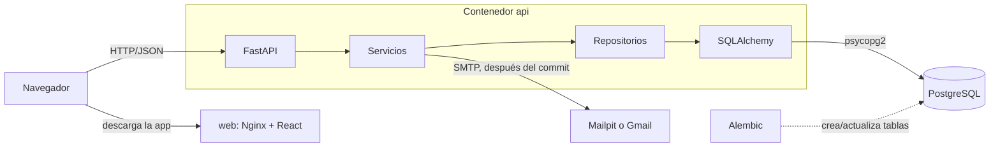
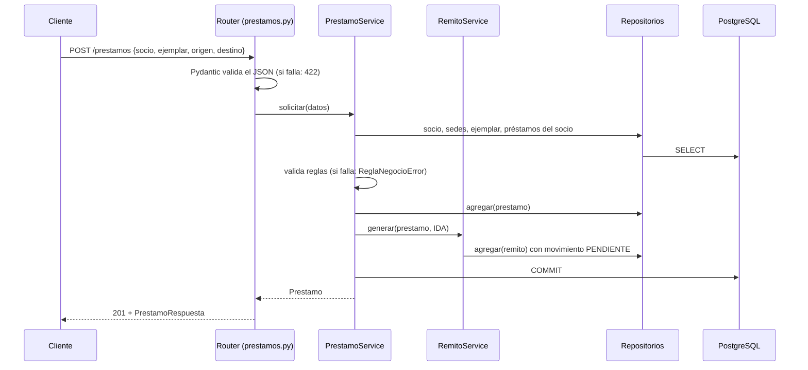
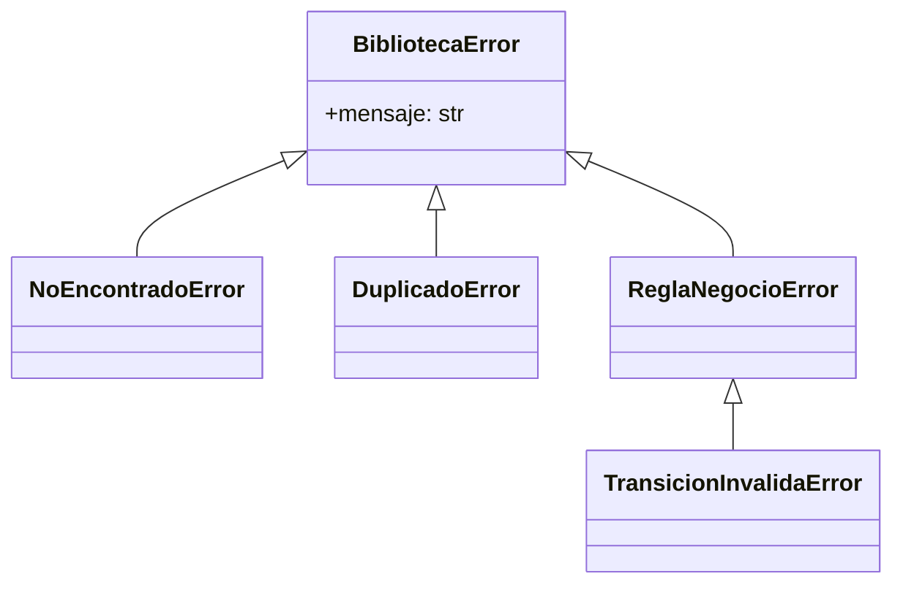
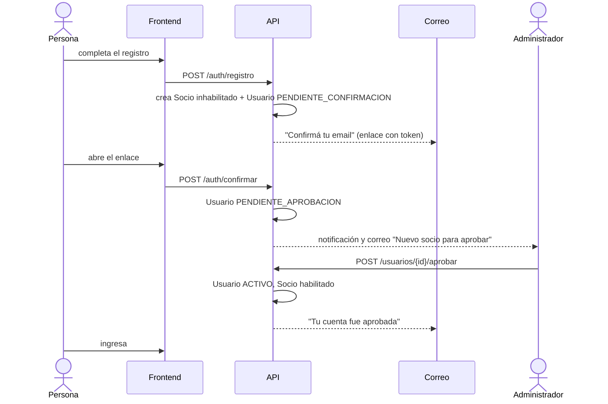
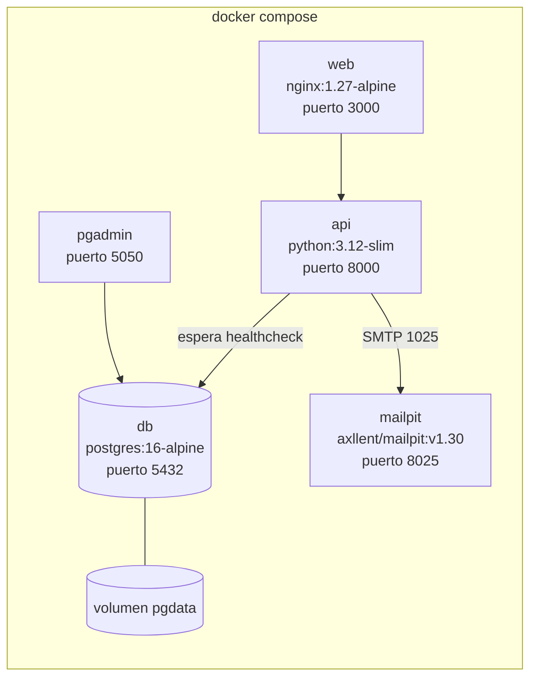

# Arquitectura

El sistema tiene dos partes: una API REST en Python (backend) y una aplicación web en React
(frontend) que la consume por HTTP. La documentación interactiva de los endpoints está en `/docs`
(Swagger) al levantar la API.

## Vista general



## Capas

```
app/
  routers/       HTTP: recibe la petición, valida la entrada, devuelve la respuesta
  schemas/       Contratos de entrada y salida (Pydantic)
  services/      Reglas de negocio, validaciones y control de la transacción
  domain/        Lógica pura sin base de datos: estados del remito, multas, enums
  repositories/  Consultas a la base
  models/        Entidades mapeadas a tablas (SQLAlchemy)
```

Cada capa solo conoce a la de abajo:

| Capa | Responsabilidad | No hace |
|---|---|---|
| Router | Traducir HTTP a llamadas al servicio | Lógica de negocio |
| Schema (DTO) | Validar formato: tipos, largos, DNI, ISBN, teléfono (`app/schemas/validaciones.py`) | Validar reglas de negocio |
| Servicio | Aplicar las reglas de la consigna, coordinar entidades, hacer commit | Armar SQL |
| Dominio | Transiciones del remito, cálculo de multas | Acceder a la base |
| Repositorio | Consultar y agregar entidades | Commit, reglas de negocio |
| Modelo | Representar la entidad y su comportamiento propio | Conocer HTTP o servicios |

`domain/` está separado para que los patrones se puedan probar sin base de datos
(`tests/test_estados_remito.py`, `tests/test_multas.py`).

### `schemas` y `domain`

- **`schemas/` son los DTO**: definen qué datos entran (`SocioCrear`, `PrestamoCrear`) y qué datos
  salen (`SocioRespuesta`, `PrestamoRespuesta`). Los de entrada validan el formato antes de llegar
  al servicio. Los de salida no validan: muestran lo que hay en la base. Además separan lo que la
  API expone del modelo interno, y Swagger los usa para documentar cada endpoint.
- **`domain/` es la lógica de negocio que no depende de la base ni de HTTP**: las clases del patrón
  State (estados del remito), las del Strategy (multas) y los enums de estados. Por eso se prueban
  sin base de datos.

Dos niveles de validación: el **formato** va en el DTO ("el DNI tiene 7 u 8 dígitos"); las
**reglas de negocio** van en el servicio ("el DNI no puede repetirse", "un socio inhabilitado no
puede pedir préstamos").

## Flujo de una petición

Ejemplo: `POST /prestamos` para un préstamo interbibliotecario.



Si cualquier validación falla, no se llega al commit. La sesión se cierra al terminar la petición
y lo que se haya hecho se descarta.

## Manejo de errores

Los servicios lanzan excepciones propias (`app/exceptions.py`), sin depender de HTTP. Un único
manejador en `app/main.py` las traduce a códigos HTTP:



| Excepción | HTTP | Ejemplo |
|---|---|---|
| `NoEncontradoError` | 404 | El socio 99 no existe |
| `DuplicadoError` | 409 | Ya existe un socio con ese DNI |
| `ReglaNegocioError` | 400 | El socio está inhabilitado |
| `TransicionInvalidaError` | 400 | No se puede despachar un remito PENDIENTE |
| Error de validación de Pydantic | 422 | Email con formato inválido |

La respuesta siempre tiene la forma `{"detail": "mensaje"}`.

## Paginación

Todos los listados están paginados, salvo `GET /sedes` (son pocas y se usan para completar
listas desplegables). Se piden con `?pagina=1&tamanio=20` (tamaño máximo 100) y responden:

```json
{
  "items": [ ... ],
  "total": 57,
  "pagina": 2,
  "tamanio": 20,
  "paginas": 3
}
```

`BaseRepository.paginar` resuelve el conteo y el corte para cualquier consulta, así cada
repositorio solo arma su consulta con filtros. Los listados tienen un orden estable (desempatan
por id) para que un elemento no aparezca en dos páginas.

## CORS

El navegador bloquea las llamadas de una página a un servidor de otro origen (otro dominio o
puerto) salvo que el servidor las autorice. Como el frontend corre en su propio servidor, la API
habilita los orígenes listados en `CORS_ORIGENES`. Por defecto son los puertos habituales de
desarrollo: 3000 (React), 5173 (Vite) y 4200 (Angular).

## Respuestas con datos relacionados

Las respuestas de préstamos, remitos, reservas, ejemplares e incidencias incluyen, además de los
ids, un resumen de las entidades relacionadas (`app/schemas/resumen.py`). Por ejemplo, un préstamo
trae `socio: {id, dni, nombre, apellido}`, `ejemplar: {codigo_inventario, libro: {titulo, autor}}`
y las dos sedes. Así una tabla del frontend se arma con una sola llamada en lugar de una por fila.

## Búsquedas

Las búsquedas por texto (socios por nombre, apellido o DNI; libros por título o autor) son
parciales e ignoran mayúsculas y tildes: "cortazar" encuentra "Cortázar". Usan la extensión
`unaccent` de Postgres, que se habilita en la migración `0003`. Los caracteres `%` y `_` que
escriba el usuario se buscan como texto, no como comodines (`contiene()` en
`app/repositories/base.py`).

## Tareas periódicas

El proceso de vencimientos (reservas no retiradas e inhabilitación por atraso) corre dentro de la
misma API: al arrancar, `app/main.py` lanza una tarea (`app/tareas.py`) que lo ejecuta y después
espera `INTERVALO_PROCESO_MINUTOS` para repetirlo. Cada ejecución abre su propia sesión de base de
datos. Si falla una vez (por ejemplo, porque la base todavía no responde), se registra en el log y
se reintenta en la siguiente vuelta.

Se eligió así en lugar de un programador externo (cron) para no sumar otro servicio. La
contrapartida es que, si se levantaran varias instancias de la API, cada una lo ejecutaría; el
proceso no daña nada si corre dos veces (un socio ya inhabilitado no se vuelve a procesar), pero
con una sola instancia, como en este proyecto, no ocurre.

## Sesión y transacciones

- `app/database.py` crea el `engine` una sola vez y define `get_db()`, que abre una sesión por
  petición y la cierra al terminar.
- Los routers reciben el servicio por inyección de dependencias (`Depends`). El servicio recibe
  la sesión en el constructor y la comparte con los repositorios que usa.
- Solo los servicios hacen `commit`, una vez por operación de negocio. Los repositorios hacen
  `flush`. La justificación está en [patrones-de-diseno.md](patrones-de-diseno.md#repository-acceso-a-datos).

## Seguridad

### Roles

| Rol | Cómo se crea | Qué puede hacer |
|---|---|---|
| Visitante (sin sesión) | - | Ver el catálogo y la disponibilidad por sede, registrarse |
| Socio | Se registra solo, confirma el email y un administrador lo aprueba | Lo anterior, más: pedir libros, ver sus préstamos, reservas, pedidos, historial y notificaciones |
| Administrador | El primero sale de la configuración (`ADMIN_EMAIL`); los demás los crea un administrador | Todo el panel: préstamos, remitos, socios, catálogo, pedidos, usuarios, inventario, reportes |

Los permisos se controlan en la capa de routers con dependencias de FastAPI
(`app/routers/dependencias.py`):

- `usuario_actual`: lee el token del encabezado `Authorization: Bearer ...` y devuelve el
  usuario. Sin token o con uno vencido responde **401**.
- `requiere_admin`: además exige el rol administrador; si no, **403**.
- `socio_actual`: exige el rol socio y devuelve su `Socio`. Los endpoints `/mi/...` lo usan, así
  un socio solo puede ver sus propios datos: el id nunca viaja en la URL.

Los routers del panel se declaran con `dependencies=SOLO_ADMIN`. En `sedes` y `libros` solo las
escrituras lo llevan: la consulta del catálogo es pública. Los servicios no conocen al usuario
conectado salvo cuando la regla lo necesita (por ejemplo, el socio que hace el pedido).

### Contraseñas y sesión

- Las contraseñas se guardan con **bcrypt** (`app/seguridad/contrasenas.py`), nunca en texto
  plano. bcrypt es lento a propósito y agrega una sal distinta a cada contraseña.
- Al ingresar, la API devuelve un **JWT** firmado con `JWT_SECRETO` (`app/seguridad/tokens.py`)
  que lleva el id del usuario, el rol y el vencimiento (`JWT_MINUTOS`, 8 horas por defecto). La
  API no guarda sesiones: verifica la firma en cada petición y vuelve a leer el usuario, así una
  cuenta rechazada deja de funcionar aunque tenga un token vigente.
- El frontend guarda el token en `localStorage` y lo agrega en cada llamada. Ante un 401 cierra
  la sesión.

### Alta de un socio



Si el DNI y el email ya corresponden a un socio cargado por la biblioteca, la cuenta se vincula
a ese socio y queda activa al confirmar el email, sin pasar por la aprobación.

El enlace de confirmación lleva un token aleatorio (`secrets.token_urlsafe`) que se borra al
usarse. La confirmación es un `POST` desde la página, no un `GET` del enlace: así un programa
que abra los enlaces del correo para revisarlos no confirma la cuenta por su cuenta.

## Correo

`app/services/correo.py` elige cómo enviar según `CORREO_MODO`:

| Modo | Clase | Uso |
|---|---|---|
| `smtp` | `CorreoSmtp` | Envía por SMTP en un hilo aparte. En desarrollo va a **Mailpit**, un buzón de prueba que recibe todo y no lo reenvía; en la demo puede ir a **Gmail** |
| `memoria` | `CorreoEnMemoria` | Tests: guarda los correos en una lista para revisarlos |
| `desactivado` | `CorreoDesactivado` | No envía nada |

Los correos salen después del `commit` (ver [Observer](patrones-de-diseno.md#observer-notificaciones)).
Si el servidor de correo no responde, se registra el error en el log y la operación sigue: el
socio igual ve la notificación en el sistema.

Los socios de los datos de ejemplo tienen emails inventados (`@example.com`) y
`recibe_correos = false`: ven sus notificaciones en el sistema pero no se les manda nada.

## Decisiones técnicas

| Decisión | Alternativa | Por qué |
|---|---|---|
| **FastAPI** | Flask | Valida la entrada con Pydantic y genera la documentación de cada endpoint (Swagger) automáticamente, que es lo que usa el equipo de frontend. |
| **PostgreSQL** | SQLite (visto en clase) | Base cliente-servidor real: soporta concurrencia, corre en su propio contenedor y es lo que se usaría en un despliegue. SQLite guarda todo en un archivo local y bloquea la base entera en cada escritura. |
| **SQLAlchemy (ORM)** | SQL con `cursor` (visto en clase) | Visto en la semana 8. Mapea las clases a tablas, maneja relaciones y transacciones, y evita escribir SQL a mano. Es el equivalente en Python a JPA / Spring Data. |
| **Alembic** | `Base.metadata.create_all()` | `create_all` solo crea tablas que no existen: no aplica cambios a tablas existentes. Alembic versiona cada cambio del esquema como una migración que se puede aplicar y revertir. |
| **Pydantic** | Validar a mano | Valida tipos y formatos antes de llegar al servicio y documenta los contratos en Swagger. |
| **Docker Compose** | Instalar todo localmente | Cualquier integrante levanta el sistema completo (base + API) con un comando y la misma versión de todo. |
| **pytest contra Postgres** | Tests con SQLite en memoria | Se prueba contra el mismo motor que en producción; algunas consultas (`ilike`, agregaciones) se comportan distinto según el motor. |
| **JWT propio + bcrypt** | Keycloak, sesiones en el servidor | Dos roles fijos y un alta con aprobación propia; ver [patrones-de-diseno.md](patrones-de-diseno.md#usuarios-y-roles-por-qué-no-keycloak). JWT no necesita guardar sesiones. |
| **Mailpit** | Mandar siempre a Gmail | Los correos de prueba no llegan a nadie real y se ven en el navegador. Gmail queda para la demo con una variable. |
| **React + Vite** | Angular, Vue | La opción más difundida y la que el grupo conoce. Vite compila rápido y recarga al guardar. |
| **JavaScript** | TypeScript | Menos configuración y curva de aprendizaje para un grupo con poco tiempo. |
| **Ant Design** | Material UI, Bootstrap | Pensada para paneles de gestión: tablas paginadas, formularios con validación, línea de tiempo y pasos ya resueltos, y traducida al español. |
| **Recharts** | Chart.js | Gráficos declarados como componentes de React. |

## Configuración

Todo se configura por variables de entorno (`app/config.py`, ejemplo en `.env.example`):

| Variable | Por defecto | Uso |
|---|---|---|
| `DATABASE_URL` | Postgres local | Conexión de la API |
| `CORS_ORIGENES` | `localhost` en 3000, 5173 y 4200 | Orígenes del frontend habilitados, separados por coma |
| `TEST_DATABASE_URL` | `biblioteca_test` local | Conexión de los tests |
| `DIAS_PRESTAMO` | 14 | Plazo del préstamo |
| `MAX_PRESTAMOS_ACTIVOS` | 3 | Préstamos en curso por socio |
| `DIAS_VALIDEZ_RESERVA` | 3 | Días para retirar una reserva disponible |
| `MULTA_MONTO_DIARIO` | 500 | Multa por día de atraso leve |
| `MULTA_DIAS_LEVES` | 7 | Hasta cuántos días el atraso es leve |
| `MULTA_MONTO_DIARIO_GRAVE` | 1000 | Multa por día a partir del día siguiente |
| `MULTA_CARGO_DANADO` | 5000 | Cargo si se devuelve dañado |
| `MULTA_CARGO_DESTRUIDO` | 20000 | Cargo si se devuelve destruido |
| `DIAS_ATRASO_INHABILITACION` | 30 | Días de atraso para inhabilitar automáticamente al socio |
| `PROCESO_AUTOMATICO` | `true` | Si la API corre sola el proceso de vencimientos |
| `INTERVALO_PROCESO_MINUTOS` | 60 | Cada cuánto lo corre |
| `DIAS_AVISO_VENCIMIENTO` | 2 | Con cuántos días de anticipación se avisa que un préstamo vence |
| `JWT_SECRETO` | texto de ejemplo | Clave con la que se firman las sesiones. **Cambiarla** fuera del entorno de desarrollo |
| `JWT_MINUTOS` | 480 | Duración de la sesión |
| `BCRYPT_RONDAS` | 12 | Costo del hash de contraseñas (los tests usan 4) |
| `ADMIN_EMAIL` / `ADMIN_CONTRASENA` | `admin@example.com` / `admin123` | Administrador que se crea al arrancar si no hay ninguno |
| `CREAR_ADMIN_AL_INICIAR` | `true` | Si la API crea ese administrador |
| `CORREO_MODO` | `smtp` | `smtp`, `memoria` o `desactivado` |
| `SMTP_HOST` / `SMTP_PUERTO` | `localhost` / 1025 (`mailpit` en Docker) | Servidor de correo |
| `SMTP_TLS`, `SMTP_USUARIO`, `SMTP_CONTRASENA` | vacíos | Para Gmail: `true`, la cuenta y una contraseña de aplicación |
| `CORREO_REMITENTE` | `Red de Bibliotecas <no-responder@example.com>` | Remitente de los correos |
| `URL_FRONTEND` | `http://localhost:3000` | Base de los enlaces de los correos |

## Despliegue



- `db`: Postgres con un volumen para que los datos sobrevivan a reinicios. Un script de inicio
  (`docker/init-db.sql`) crea además la base `biblioteca_test`.
- `api`: la imagen se construye con el `Dockerfile`. Al arrancar, `docker/entrypoint.sh` aplica
  las migraciones pendientes (`alembic upgrade head`) y después levanta uvicorn. Arranca recién
  cuando la base responde (`depends_on` con `service_healthy`).
- `web`: el `frontend/Dockerfile` compila la aplicación con Node y la sirve con Nginx
  (`frontend/nginx.conf`). La URL de la API se fija al compilar (`VITE_API_URL`). Nginx devuelve
  `index.html` para cualquier ruta, así funcionan las direcciones del panel (`/remitos/3`) al
  recargar la página.
- `mailpit`: buzón de prueba. Recibe todos los correos que manda la API y los muestra en
  http://localhost:8025. No los reenvía a nadie.
- `pgadmin`: administrador de la base desde el navegador. Viene con la conexión a `db` ya
  configurada (`docker/pgadmin-servers.json`) y en modo escritorio, sin pantalla de login.

## Tests

| Archivo | Qué prueba | Base de datos |
|---|---|---|
| `test_estados_remito.py` | Patrón State: transiciones válidas, inválidas e historial | No |
| `test_multas.py` | Patrón Strategy: cada estrategia y el cambio entre ellas | No |
| `test_prestamos.py` | Préstamos locales e inter-sede, remitos, devoluciones y validaciones | Sí |
| `test_reservas.py` | Reservas, orden de llegada, vencimientos | Sí |
| `test_reportes.py` | Los seis reportes con datos armados | Sí |
| `test_incidencias.py` | Revisión de recepción: daño, destrucción, extravío y listado de incidencias | Sí |
| `test_historial.py` | Historial de lecturas del socio | Sí |
| `test_api.py` | Endpoints, códigos HTTP, paginación y CORS | Sí |
| `test_cuentas.py` | Registro, confirmación de email, aprobación, ingreso, tokens, correos | Sí |
| `test_permisos.py` | Qué puede hacer cada rol y sin sesión (401/403) | Sí |
| `test_pedidos.py` | Pedidos del socio: validaciones, reservar, traer de otra sede, rechazar | Sí |
| `test_notificaciones.py` | Patrón Observer: cada evento llega a quien corresponde, por cada canal | Sí |
| `test_inventario.py` | Recuento: encontrados, faltantes, fuera de lugar, desconocidos, cierre | Sí |

Cada test corre dentro de una transacción que se revierte al terminar (`tests/conftest.py`), así
los tests no dependen entre sí ni del orden en que se ejecutan. GitHub Actions corre la suite y
prueba las migraciones (ida y vuelta) en cada push; también revisa (ESLint) y compila el frontend.

## Frontend

```
frontend/src/
  api/          una función por endpoint, agrupadas por recurso
  componentes/  etiquetas de estado, selectores con búsqueda, encabezados
  hooks/        useListado, useCarga, useAccion
  layouts/      panel del administrador y sitio público / área del socio
  paginas/      una pantalla por sección (panel, publico, socio, compartido)
  sesion/       usuario conectado, guarda de rutas por rol
  utiles/       textos y colores de los estados, formatos, reglas de validación
```

- **Tres áreas**: el catálogo público (`/`, sin login, más `/ingresar`, `/registro` y
  `/confirmar`), el área del socio (`/socio`) y el panel del administrador (`/panel`).
  `RutaProtegida` manda a ingresar a quien no tiene sesión y a su propia área a quien tiene
  otro rol. Es solo comodidad: la protección real está en la API.
- **Notificaciones**: una campana con la cantidad sin leer, que se consulta cada 30 segundos.
- **Llamadas a la API**: centralizadas en `src/api/`. Un interceptor de axios convierte los
  errores en un `Error` con el mensaje del backend, que las pantallas muestran tal cual. Las
  reglas de negocio no se duplican en el front.
- **Listados**: el hook `useListado` maneja la paginación del backend, los filtros y la recarga.
- **Carga por pantalla**: cada página se descarga recién cuando se visita (`React.lazy`), así la
  primera carga no incluye, por ejemplo, la librería de gráficos de Reportes.
- **Gráficos**: barras horizontales con una paleta validada para daltonismo, y siempre una tabla
  con los mismos datos al lado.
