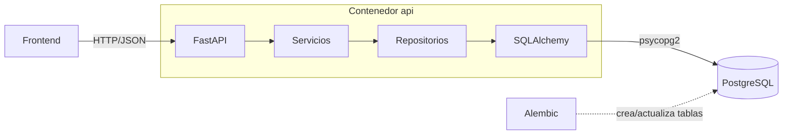
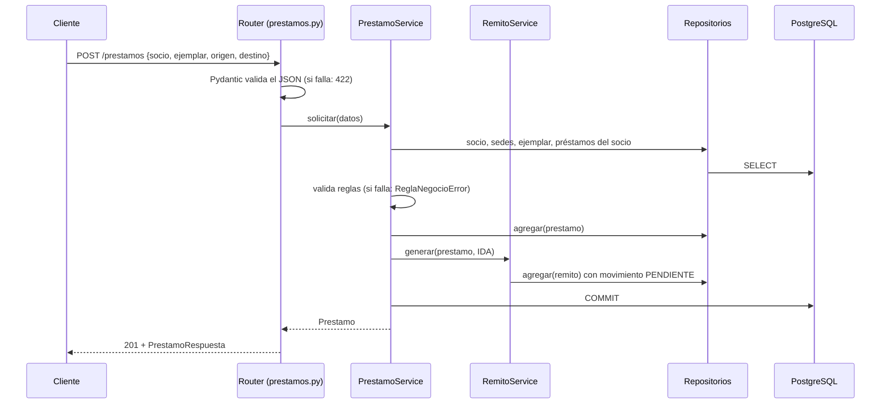
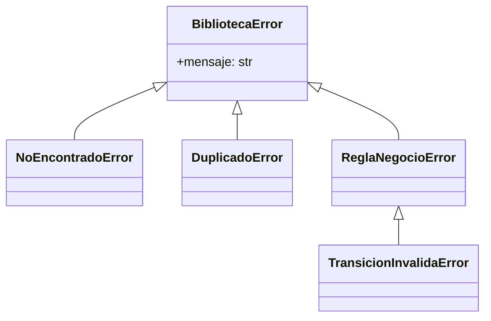
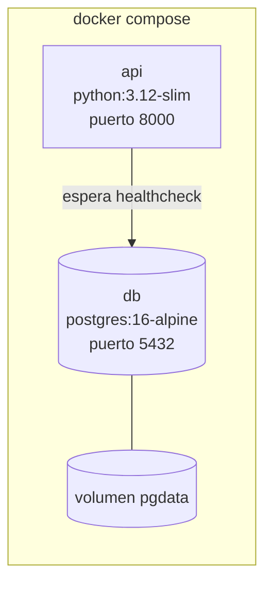

# Arquitectura

El sistema es una API REST en Python. El frontend, desarrollado aparte, la consume por HTTP. La
documentación interactiva de los endpoints está en `/docs` (Swagger) al levantar la API.

## Vista general



## Capas

```
app/
  routers/       HTTP: recibe la petición, valida la entrada, devuelve la respuesta
  schemas/       Contratos de entrada y salida (Pydantic)
  services/      Reglas de negocio, validaciones y control de la transacción
  domain/        Lógica pura sin base de datos: estados del remito, multas, enums
  repositories/  Consultas a la base
  models/        Entidades mapeadas a tablas (SQLAlchemy)
```

Cada capa solo conoce a la de abajo:

| Capa | Responsabilidad | No hace |
|---|---|---|
| Router | Traducir HTTP a llamadas al servicio | Lógica de negocio |
| Schema | Validar formato (tipos, largos, email, DNI numérico) | Validar reglas de negocio |
| Servicio | Aplicar las reglas de la consigna, coordinar entidades, hacer commit | Armar SQL |
| Dominio | Transiciones del remito, cálculo de multas | Acceder a la base |
| Repositorio | Consultar y agregar entidades | Commit, reglas de negocio |
| Modelo | Representar la entidad y su comportamiento propio | Conocer HTTP o servicios |

`domain/` está separado para que los patrones se puedan probar sin base de datos
(`tests/test_estados_remito.py`, `tests/test_multas.py`).

## Flujo de una petición

Ejemplo: `POST /prestamos` para un préstamo interbibliotecario.



Si cualquier validación falla, no se llega al commit. La sesión se cierra al terminar la petición
y lo que se haya hecho se descarta.

## Manejo de errores

Los servicios lanzan excepciones propias (`app/exceptions.py`), sin depender de HTTP. Un único
manejador en `app/main.py` las traduce a códigos HTTP:



| Excepción | HTTP | Ejemplo |
|---|---|---|
| `NoEncontradoError` | 404 | El socio 99 no existe |
| `DuplicadoError` | 409 | Ya existe un socio con ese DNI |
| `ReglaNegocioError` | 400 | El socio está inhabilitado |
| `TransicionInvalidaError` | 400 | No se puede despachar un remito PENDIENTE |
| Error de validación de Pydantic | 422 | Email con formato inválido |

La respuesta siempre tiene la forma `{"detail": "mensaje"}`.

## Sesión y transacciones

- `app/database.py` crea el `engine` una sola vez y define `get_db()`, que abre una sesión por
  petición y la cierra al terminar.
- Los routers reciben el servicio por inyección de dependencias (`Depends`). El servicio recibe
  la sesión en el constructor y la comparte con los repositorios que usa.
- Solo los servicios hacen `commit`, una vez por operación de negocio. Los repositorios hacen
  `flush`. La justificación está en [patrones-de-diseno.md](patrones-de-diseno.md#repository-acceso-a-datos).

## Decisiones técnicas

| Decisión | Alternativa | Por qué |
|---|---|---|
| **FastAPI** | Flask | Valida la entrada con Pydantic y genera la documentación de cada endpoint (Swagger) automáticamente, que es lo que usa el equipo de frontend. |
| **PostgreSQL** | SQLite (visto en clase) | Base cliente-servidor real: soporta concurrencia, corre en su propio contenedor y es lo que se usaría en un despliegue. SQLite guarda todo en un archivo local y bloquea la base entera en cada escritura. |
| **SQLAlchemy (ORM)** | SQL con `cursor` (visto en clase) | Visto en la semana 8. Mapea las clases a tablas, maneja relaciones y transacciones, y evita escribir SQL a mano. Es el equivalente en Python a JPA / Spring Data. |
| **Alembic** | `Base.metadata.create_all()` | `create_all` solo crea tablas que no existen: no aplica cambios a tablas existentes. Alembic versiona cada cambio del esquema como una migración que se puede aplicar y revertir. |
| **Pydantic** | Validar a mano | Valida tipos y formatos antes de llegar al servicio y documenta los contratos en Swagger. |
| **Docker Compose** | Instalar todo localmente | Cualquier integrante levanta el sistema completo (base + API) con un comando y la misma versión de todo. |
| **pytest contra Postgres** | Tests con SQLite en memoria | Se prueba contra el mismo motor que en producción; algunas consultas (`ilike`, agregaciones) se comportan distinto según el motor. |
| **Sin autenticación** | Login con roles | La consigna no lo pide. Se puede agregar sin cambiar los servicios. |

## Configuración

Todo se configura por variables de entorno (`app/config.py`, ejemplo en `.env.example`):

| Variable | Por defecto | Uso |
|---|---|---|
| `DATABASE_URL` | Postgres local | Conexión de la API |
| `TEST_DATABASE_URL` | `biblioteca_test` local | Conexión de los tests |
| `DIAS_PRESTAMO` | 14 | Plazo del préstamo |
| `MAX_PRESTAMOS_ACTIVOS` | 3 | Préstamos en curso por socio |
| `DIAS_VALIDEZ_RESERVA` | 3 | Días para retirar una reserva disponible |
| `MULTA_ESTRATEGIA` | `fija` | `fija` o `escalonada` |
| `MULTA_MONTO_DIARIO` | 500 | Monto base de la multa |

## Despliegue



- `db`: Postgres con un volumen para que los datos sobrevivan a reinicios. Un script de inicio
  (`docker/init-db.sql`) crea además la base `biblioteca_test`.
- `api`: la imagen se construye con el `Dockerfile`. Al arrancar, `docker/entrypoint.sh` aplica
  las migraciones pendientes (`alembic upgrade head`) y después levanta uvicorn. Arranca recién
  cuando la base responde (`depends_on` con `service_healthy`).

## Tests

| Archivo | Qué prueba | Base de datos |
|---|---|---|
| `test_estados_remito.py` | Patrón State: transiciones válidas, inválidas e historial | No |
| `test_multas.py` | Patrón Strategy: cada estrategia y el cambio entre ellas | No |
| `test_prestamos.py` | Préstamos locales e inter-sede, remitos, devoluciones y validaciones | Sí |
| `test_reservas.py` | Reservas, orden de llegada, vencimientos | Sí |
| `test_reportes.py` | Los seis reportes con datos armados | Sí |
| `test_api.py` | Endpoints y códigos HTTP | Sí |

Cada test corre dentro de una transacción que se revierte al terminar (`tests/conftest.py`), así
los tests no dependen entre sí ni del orden en que se ejecutan. GitHub Actions corre la suite y
prueba las migraciones (ida y vuelta) en cada push.
