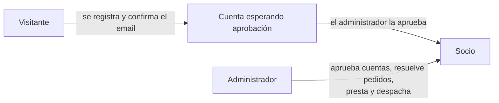

# Manuales de usuario

Guías de uso del sistema de préstamos interbibliotecarios, una por cada tipo de acceso. Todas las
capturas se tomaron del sistema funcionando, con los datos de ejemplo del seed
(`python -m app.seed`).

| Manual | Para quién | Qué cubre |
|---|---|---|
| [Visitante](manual-visitante.md) | Cualquier persona, sin cuenta | Consultar el catálogo y la disponibilidad, registrarse como socio, confirmar el email e ingresar |
| [Socio](manual-socio.md) | Socios con cuenta aprobada | Pedir libros, seguir los pedidos, ver préstamos, reservas, historial de lectura y notificaciones |
| [Administrador](manual-administrador.md) | Personal de la biblioteca | Todo el panel de gestión: pedidos, préstamos, remitos, reservas, catálogo, inventario, etiquetas, socios, usuarios, sedes, incidencias y reportes |

## Antes de empezar

El sistema se levanta con `docker compose up --build` (ver
[Despliegue local](../despliegue-local.md)). Con todo andando:

| Qué | Dirección |
|---|---|
| Sistema (catálogo, área del socio y panel) | http://localhost:3000 |
| Mailpit, la bandeja donde llegan los correos del sistema | http://localhost:8025 |

Usuarios de prueba que crea el seed:

| Rol | Email | Contraseña |
|---|---|---|
| Administrador | `admin@example.com` | `admin123` |
| Socio | `martin.gomez@example.com` (o cualquier otro socio de ejemplo) | `socio123` |

## Los tres tipos de acceso

- El **visitante** solo consulta: ve el catálogo y en qué sedes hay ejemplares libres.
- El **socio** pide libros y sigue sus préstamos desde su área personal.
- El **administrador** gestiona toda la red desde el panel. Los administradores no se registran:
  el primero se crea al arrancar y los demás los da de alta otro administrador.
