# Manual del socio

Este manual es para los **socios con la cuenta aprobada**. Explica cómo pedir libros, seguir los
pedidos y consultar los préstamos, las reservas, el historial de lectura y los avisos de la
biblioteca. Para crear la cuenta, ver el [manual del visitante](manual-visitante.md#5-hacerse-socio).

Los ejemplos usan a **Martín Gómez** (`martin.gomez@example.com` / `socio123`), uno de los socios
de ejemplo del seed.

Índice:

1. [Ingresar](#1-ingresar)
2. [La barra del socio](#2-la-barra-del-socio)
3. [Mis préstamos](#3-mis-préstamos)
4. [Pedir un libro](#4-pedir-un-libro)
5. [Mis pedidos](#5-mis-pedidos)
6. [Historial de lectura](#6-historial-de-lectura)
7. [Notificaciones](#7-notificaciones)
8. [Reservas listas para retirar](#8-reservas-listas-para-retirar)
9. [Vencimientos, multas e inhabilitación](#9-vencimientos-multas-e-inhabilitación)
10. [Reglas para tener en cuenta](#10-reglas-para-tener-en-cuenta)

---

## 1. Ingresar

Desde **Ingresar**, con el email y la contraseña de la cuenta:

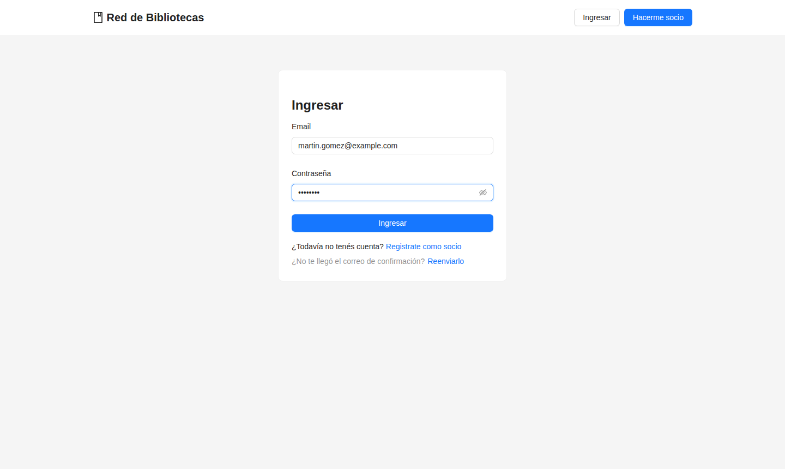

Al ingresar, el sistema abre **Mis préstamos**. La sesión queda guardada en el navegador:
recargar la página no la cierra.

## 2. La barra del socio

Arriba de todas las pantallas del socio hay:

- Las secciones: **Catálogo**, **Mis préstamos**, **Mis pedidos**, **Historial de lectura** y
  **Notificaciones**.
- La **campana**, con un número rojo que indica los avisos sin leer. Al hacer clic muestra los
  últimos avisos, con los enlaces *Marcar todas como leídas* y *Ver todas*.

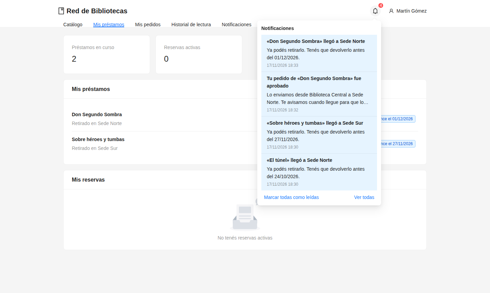

- El **nombre del socio**. Al hacer clic muestra el email de la cuenta y la opción
  **Cerrar sesión**.

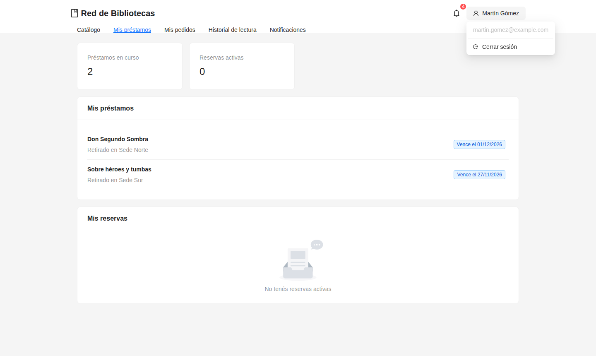

## 3. Mis préstamos

Es la pantalla principal del socio. Muestra:

- **Préstamos en curso** y **Reservas activas**: cuántos tiene en este momento.
- **Mis préstamos**: cada libro que tiene, en qué sede lo retiró y hasta cuándo puede tenerlo
  (*Vence el ...*).
- **Mis reservas**: los libros que la biblioteca le apartó o por los que está en lista de espera.

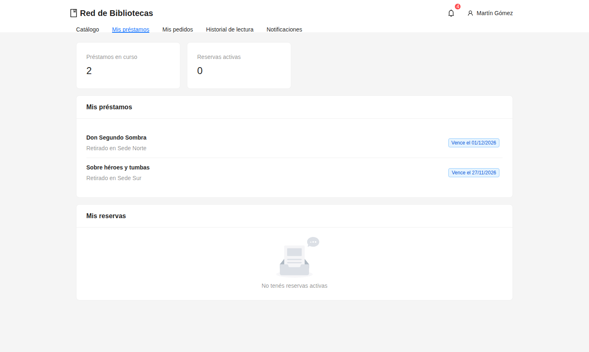

## 4. Pedir un libro

Los libros se piden desde el **Catálogo**. La pantalla es la misma que ve un visitante: se busca
por título o autor, y al hacer clic en un libro se ve en qué sedes hay ejemplares libres.

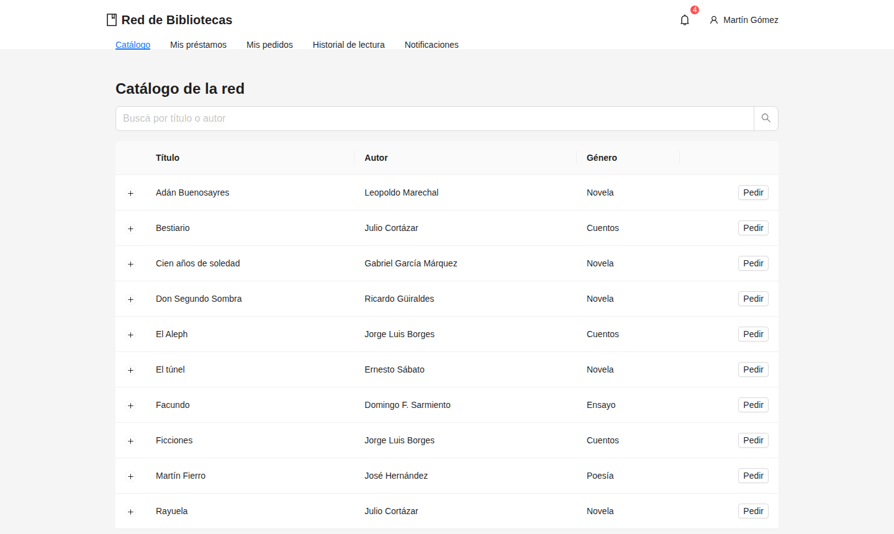

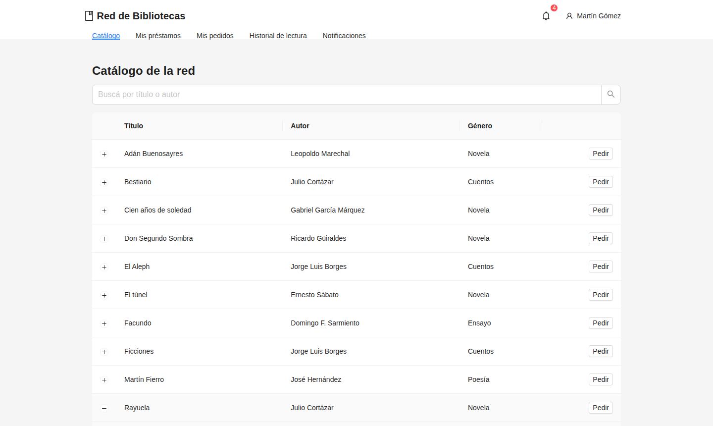

Para pedirlo, se aprieta **Pedir** en la fila del libro. Se abre una ventana para elegir:

- **Sede donde lo retirás** (obligatoria). Cada sede indica cuántos ejemplares libres tiene en
  ese momento, o *sin ejemplares libres*.
- **Comentario** (opcional, hasta 300 caracteres). Por ejemplo, para cuándo se necesita.

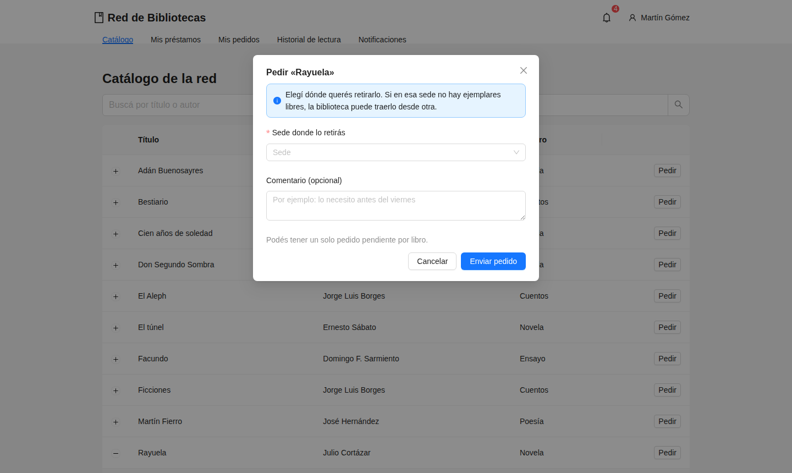

Se puede elegir una sede **sin ejemplares libres**: en ese caso la biblioteca puede traerlo
desde otra sede o anotar al socio en la lista de espera.

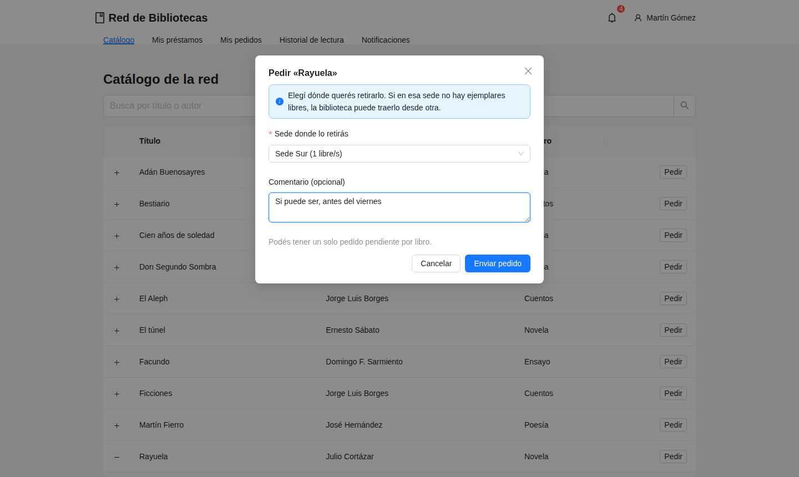

Con **Enviar pedido**, el pedido le llega a la biblioteca y el sistema lleva a **Mis pedidos**.

## 5. Mis pedidos

Lista todos los pedidos con su fecha, el libro, la sede de retiro, el **estado** y la
**respuesta de la biblioteca**. Con el filtro de **Estado** (arriba a la derecha) se ven solo los
de un estado. El botón **Pedir un libro** vuelve al catálogo.

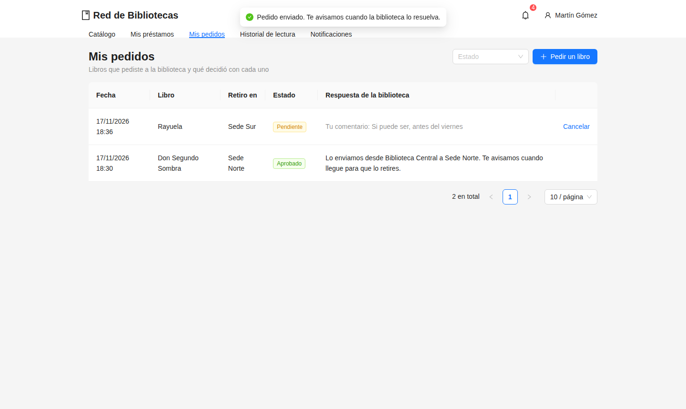

Estados de un pedido:

| Estado | Qué significa |
|---|---|
| **Pendiente** | La biblioteca todavía no lo resolvió |
| **Aprobado** | La biblioteca lo atendió. La respuesta dice cómo: se reservó un ejemplar en la sede pedida, se anotó al socio en la lista de espera o se trae el libro desde otra sede |
| **Rechazado** | La biblioteca no puede atenderlo. La respuesta muestra el motivo |
| **Cancelado** | El socio lo canceló |

Mientras está **pendiente**, el pedido se puede cancelar con **Cancelar** (pide confirmación):

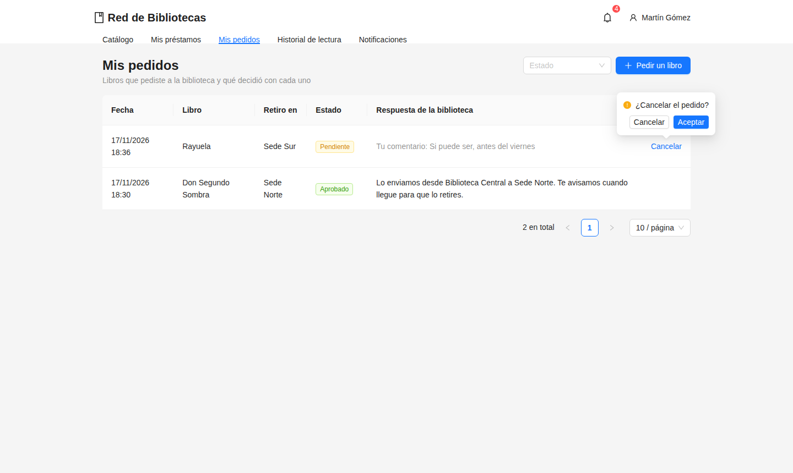

¿Qué pasa después de que lo aprueban?

- **Si se reservó en la sede pedida**, aparece en *Mis reservas* y hay unos días para retirarlo
  (ver la [sección 8](#8-reservas-listas-para-retirar)).
- **Si se trae desde otra sede**, el libro viaja con un remito. Cuando llega a la sede elegida,
  llega el aviso *«Libro» llegó a Sede ...* y recién ahí empieza a correr el plazo del préstamo:
  los días de viaje no se descuentan.

## 6. Historial de lectura

Muestra los libros que el socio **ya devolvió**, del más reciente al más antiguo: autor, sede
donde lo retiró, tipo de préstamo (*Local* o *Inter-sede*), fechas y si lo devolvió **en
término** o con atraso (y la multa que se cobró).

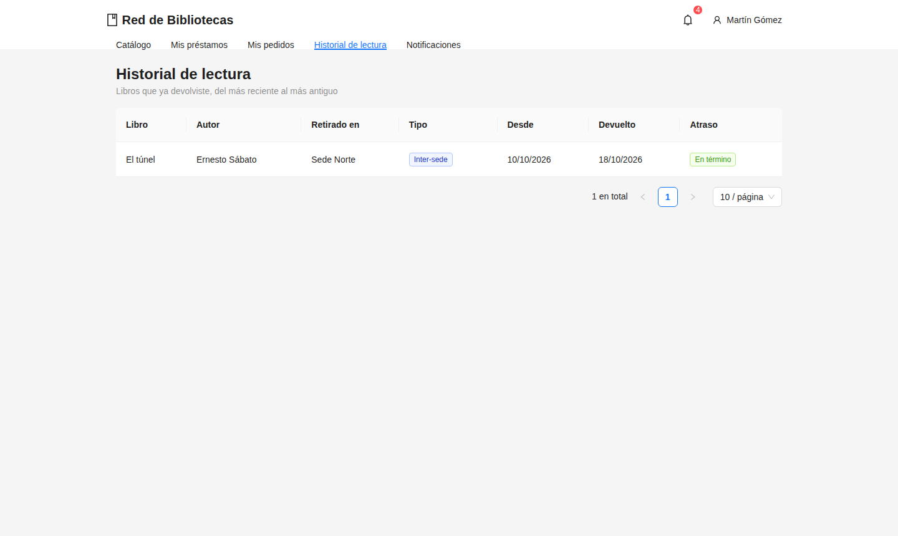

## 7. Notificaciones

La sección **Notificaciones** muestra todos los avisos, paginados. Los que no se leyeron tienen
un punto rojo. Arriba se puede elegir entre **Todas** y **Sin leer**, y marcar todas como leídas.

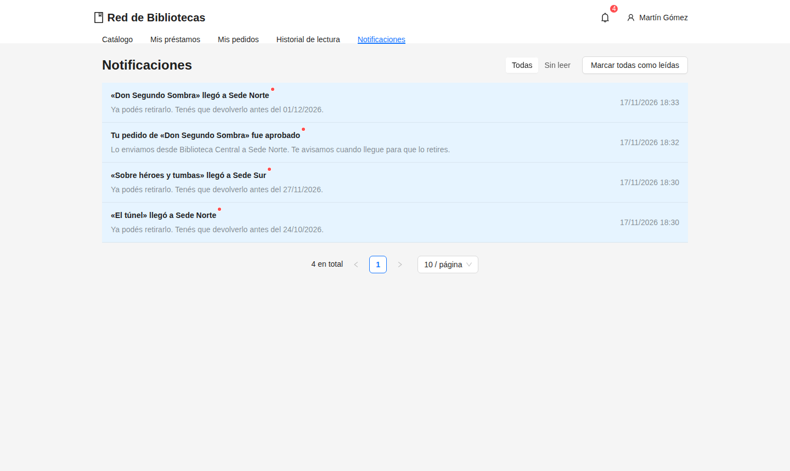

Avisos que puede recibir un socio:

| Aviso | Cuándo llega |
|---|---|
| Cuenta aprobada o rechazada | Cuando un administrador revisa el registro |
| Pedido aprobado o rechazado | Cuando la biblioteca resuelve un pedido (con el detalle o el motivo) |
| Reserva lista para retirar | Cuando se le aparta un ejemplar |
| El libro llegó a la sede | Cuando llega un libro que se trajo desde otra sede |
| El préstamo vence pronto | Cuando faltan 2 días o menos para el vencimiento |
| El préstamo venció | Cuando pasó la fecha de vencimiento sin devolverlo |
| Cuenta inhabilitada | Cuando se inhabilita al socio, con el motivo |

Si la cuenta tiene activado el correo, el aviso también llega por mail. En este proyecto los
correos quedan en Mailpit (http://localhost:8025):

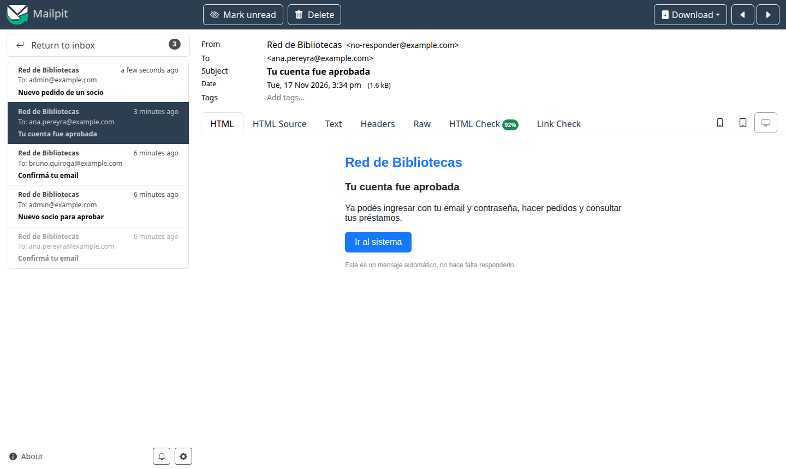

## 8. Reservas listas para retirar

Cuando la biblioteca le aparta un ejemplar, la reserva aparece en **Mis reservas** con el estado
**Lista para retirar**, la sede y la fecha límite. Hay **3 días** para retirarla: pasado ese
plazo, la reserva vence y el ejemplar pasa al siguiente socio en espera.

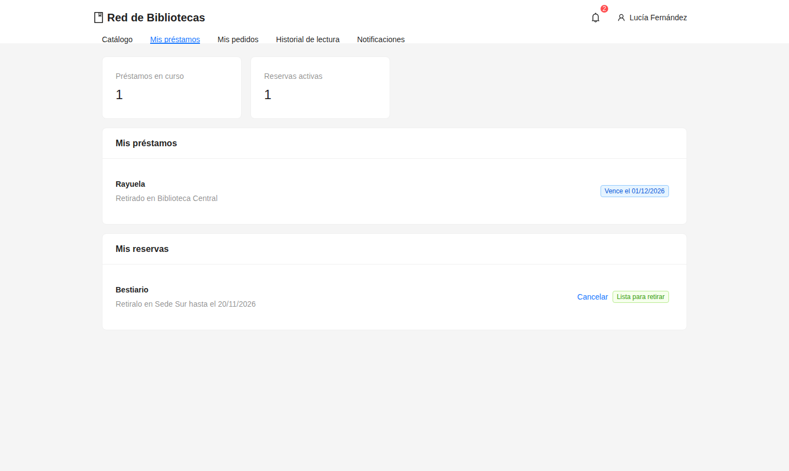

Si ya no se necesita, se puede **Cancelar** desde la misma tarjeta.

Una reserva **En espera** significa que en esa sede no había ejemplares libres. Las reservas en
espera se atienden por orden de llegada: cuando se libera un ejemplar, se le asigna al primero de
la lista y le llega el aviso.

## 9. Vencimientos, multas e inhabilitación

- Un **préstamo vencido** se muestra en rojo con los días de atraso y la multa a la fecha.
- Mientras tenga un préstamo vencido, el socio **no puede pedir otro libro**.
- Si un préstamo pasa **más de 30 días vencido**, la cuenta queda **inhabilitada**. Arriba de
  *Mis préstamos* aparece el aviso con el motivo:

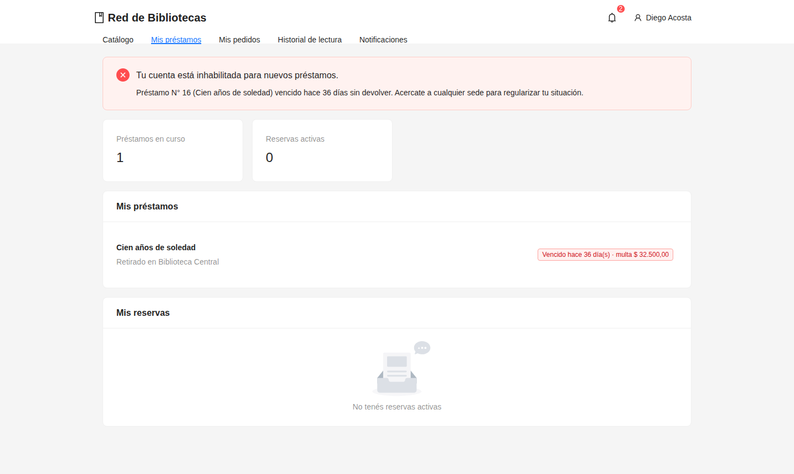

Un socio inhabilitado no puede hacer pedidos. Si lo intenta, el sistema lo rechaza:

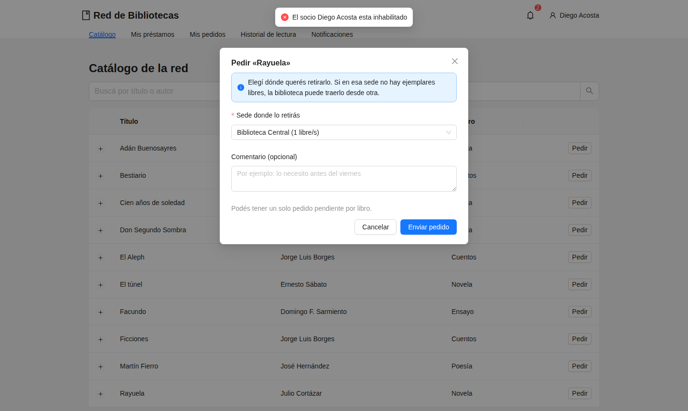

Para volver a operar, hay que devolver el libro en cualquier sede. Después, un administrador
vuelve a habilitar la cuenta.

Cómo se calcula la multa al devolver:

| Situación | Multa |
|---|---|
| Atraso de 1 a 7 días | $500 por día |
| Atraso de 8 días o más | Los primeros 7 días a $500 y los siguientes a $1.000 |
| Devuelto dañado | Se suman $5.000 |
| Devuelto destruido | Se suman $20.000 |

## 10. Reglas para tener en cuenta

- Se pueden tener hasta **3 préstamos en curso** a la vez.
- Un préstamo dura **14 días**. Si el libro viene desde otra sede, el plazo empieza cuando llega.
- Solo puede haber **un pedido pendiente por libro**, y no se puede pedir un libro que ya está
  reservado para el mismo socio.
- Solo se pueden pedir libros que tengan al menos un ejemplar en circulación en la red.
- La sede de retiro tiene que estar activa.
