# Manual del visitante

Este manual es para cualquier persona que entra al sistema **sin haber iniciado sesión**. Sin
cuenta se puede consultar el catálogo de toda la red de bibliotecas; para pedir libros hay que
hacerse socio.

Índice:

1. [El catálogo](#1-el-catálogo)
2. [Buscar un libro](#2-buscar-un-libro)
3. [Ver en qué sedes está disponible](#3-ver-en-qué-sedes-está-disponible)
4. [Pedir un libro sin tener cuenta](#4-pedir-un-libro-sin-tener-cuenta)
5. [Hacerse socio](#5-hacerse-socio)
6. [Confirmar el email](#6-confirmar-el-email)
7. [Esperar la aprobación](#7-esperar-la-aprobación)
8. [Ingresar](#8-ingresar)
9. [Mensajes de error al ingresar](#9-mensajes-de-error-al-ingresar)

---

## 1. El catálogo

Al abrir http://localhost:3000 aparece el **Catálogo de la red**: todos los libros que tienen las
sedes, con título, autor y género. Arriba a la derecha están los botones **Ingresar** (para
quien ya tiene cuenta) y **Hacerme socio** (para registrarse).

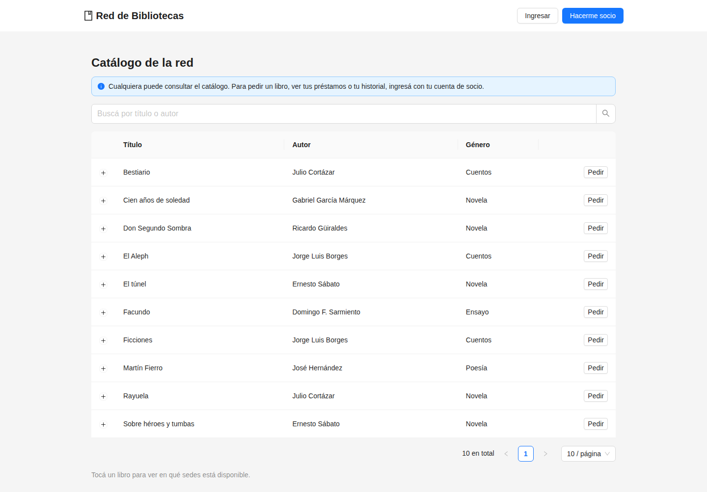

El listado está paginado: abajo se elige la página y cuántos libros se muestran por página.

## 2. Buscar un libro

La barra de búsqueda filtra por **título o autor**. Se escribe el texto y se aprieta Enter o la
lupa. La búsqueda ignora mayúsculas y tildes: "borges" encuentra "Jorge Luis Borges" y "sabato"
encuentra "Ernesto Sábato".

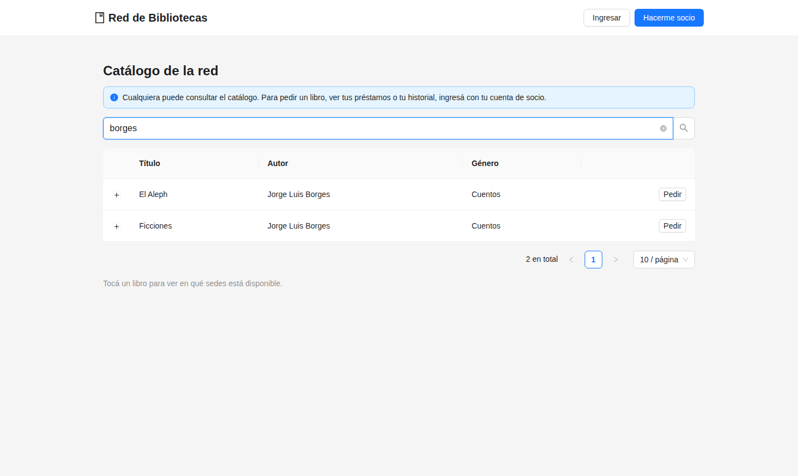

Para volver a ver todos los libros, se borra el texto con la cruz del buscador.

## 3. Ver en qué sedes está disponible

Al hacer clic en un libro (o en el **+** de la izquierda) se despliega la disponibilidad en cada
sede:

- **N disponible(s)**, en verde: hay ejemplares libres para retirar.
- **Sin ejemplares libres**: la sede tiene el libro, pero todos sus ejemplares están prestados,
  reservados o viajando.

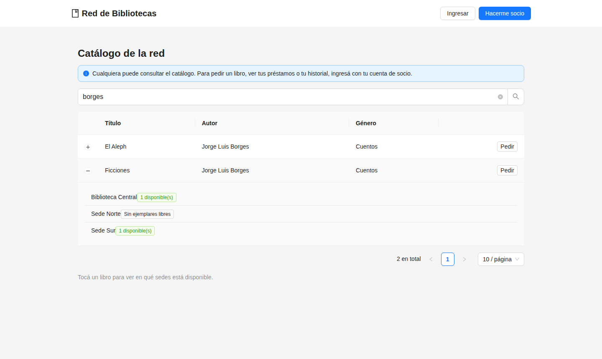

Que una sede no tenga ejemplares libres no impide pedirlo: la biblioteca puede traerlo desde otra
sede (ver el [manual del socio](manual-socio.md)).

## 4. Pedir un libro sin tener cuenta

Cada libro tiene un botón **Pedir**. Sin sesión iniciada, el sistema lleva a la pantalla de
**Ingresar**. Después de ingresar, el socio vuelve al catálogo para terminar el pedido.

## 5. Hacerse socio

Con el botón **Hacerme socio** (o con el enlace *Registrate como socio* de la pantalla de
ingreso) se abre el formulario de registro.

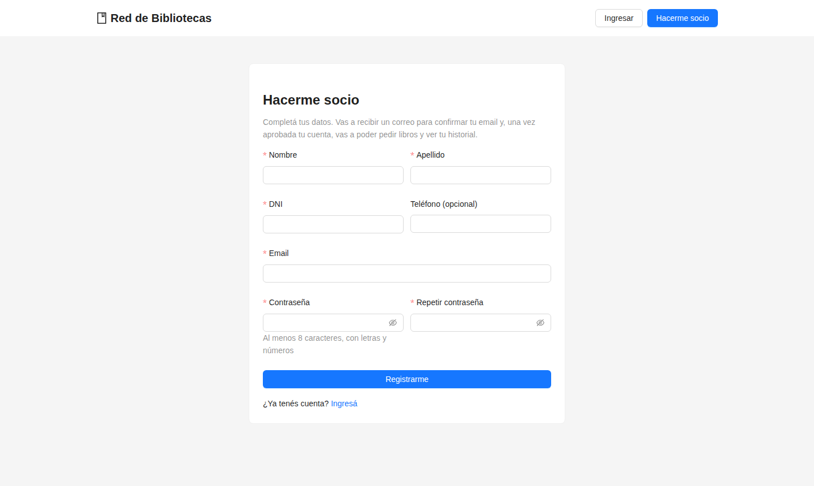

Datos que pide:

| Campo | Regla |
|---|---|
| Nombre y apellido | Obligatorios. Solo letras, entre 2 y 50 caracteres |
| DNI | Obligatorio. 7 u 8 dígitos (los puntos se quitan solos) |
| Teléfono | Opcional. Solo números, entre 6 y 15 dígitos |
| Email | Obligatorio. Tiene que ser un email válido y no estar usado por otra cuenta |
| Contraseña | Obligatoria. Al menos 8 caracteres, con letras y números |
| Repetir contraseña | Tiene que coincidir con la anterior |

Si falta algo o un dato no cumple el formato, el formulario lo marca en rojo antes de enviar:

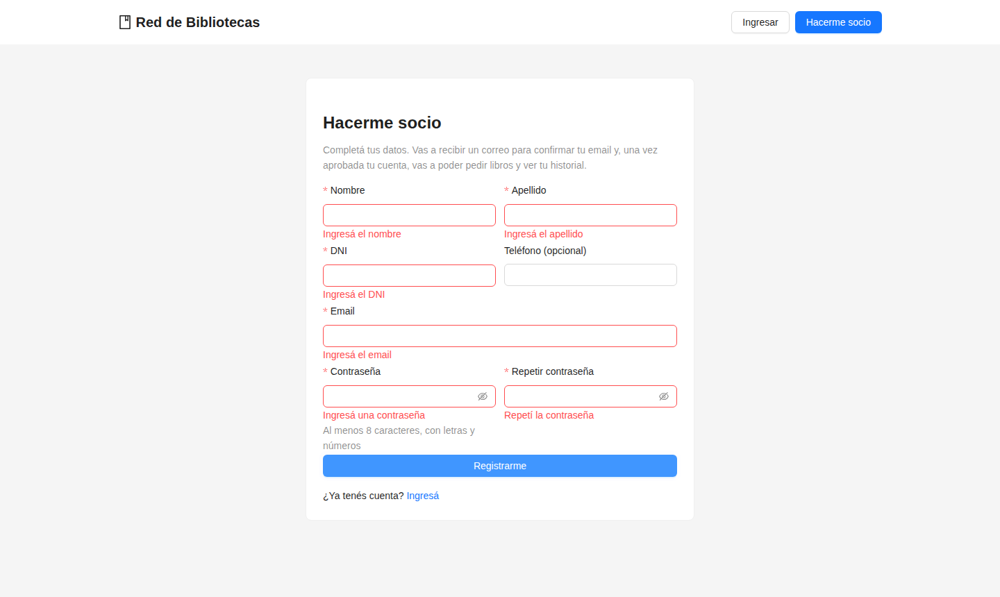

Con todo completo se aprieta **Registrarme**:

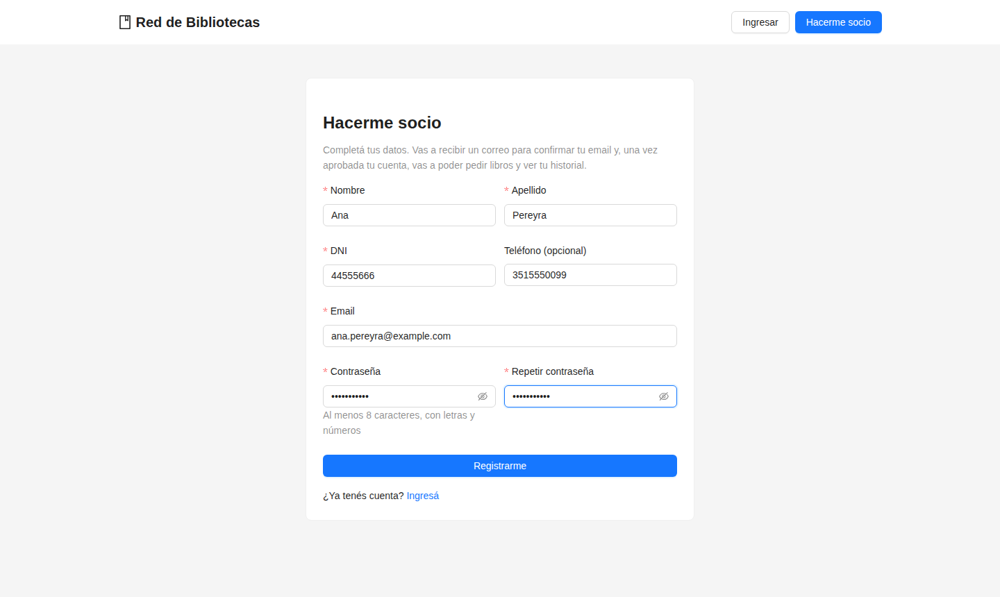

El sistema confirma que mandó un correo para validar el email:

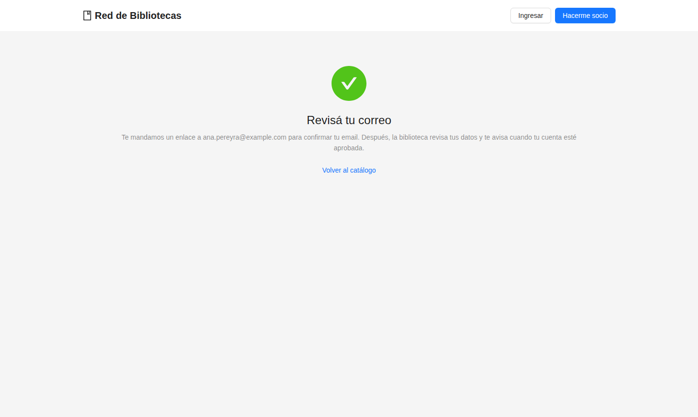

> Si el DNI ya corresponde a un socio que la biblioteca cargó antes, el email tiene que ser el
> mismo que tiene registrado. En ese caso la cuenta queda vinculada a ese socio y no necesita
> aprobación.

## 6. Confirmar el email

Al email indicado llega el correo **Confirmá tu email**. En este proyecto los correos no salen a
internet: quedan en **Mailpit** (http://localhost:8025), una bandeja de prueba que muestra todo
lo que manda el sistema.

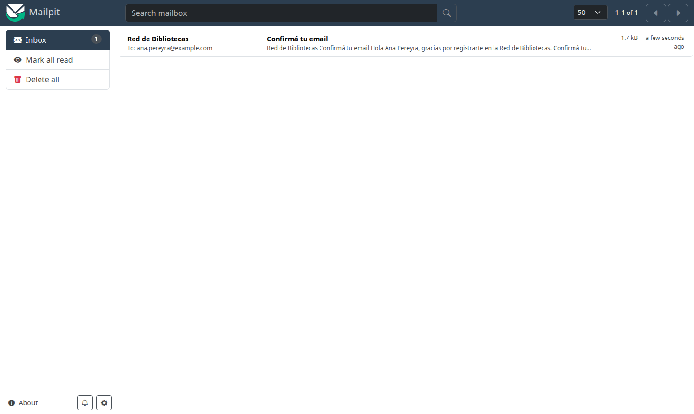

Al abrir el correo aparece el botón **Ir al sistema**, que lleva a la confirmación:

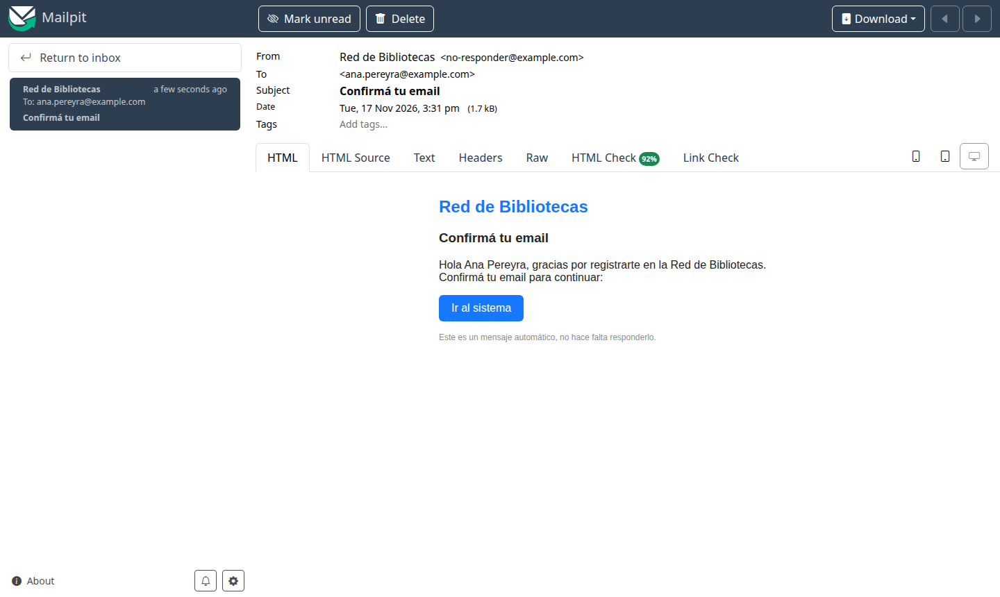

Al hacer clic, el sistema confirma el email:

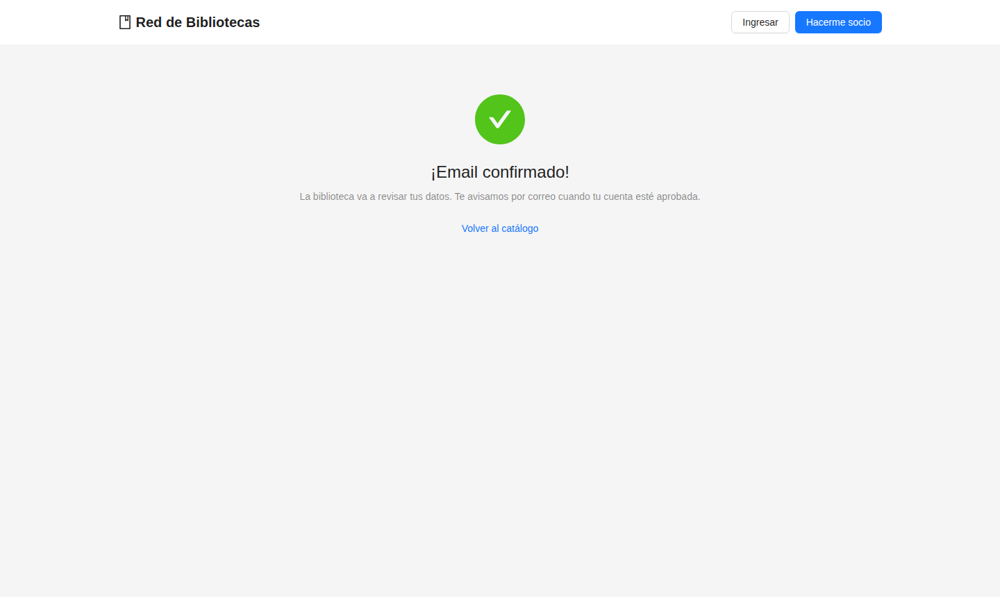

Si el correo no llegó, desde la pantalla **Ingresar** se puede pedir otro con el enlace
**Reenviarlo** (hay que escribir antes el email en el formulario).

## 7. Esperar la aprobación

Con el email confirmado, la cuenta queda **esperando aprobación**. Los administradores reciben un
aviso ("Nuevo socio para aprobar") y deciden:

- Si la **aprueban**, llega el correo *Tu cuenta fue aprobada* y ya se puede ingresar.
- Si la **rechazan**, llega un correo con el motivo.

## 8. Ingresar

La pantalla **Ingresar** pide email y contraseña.

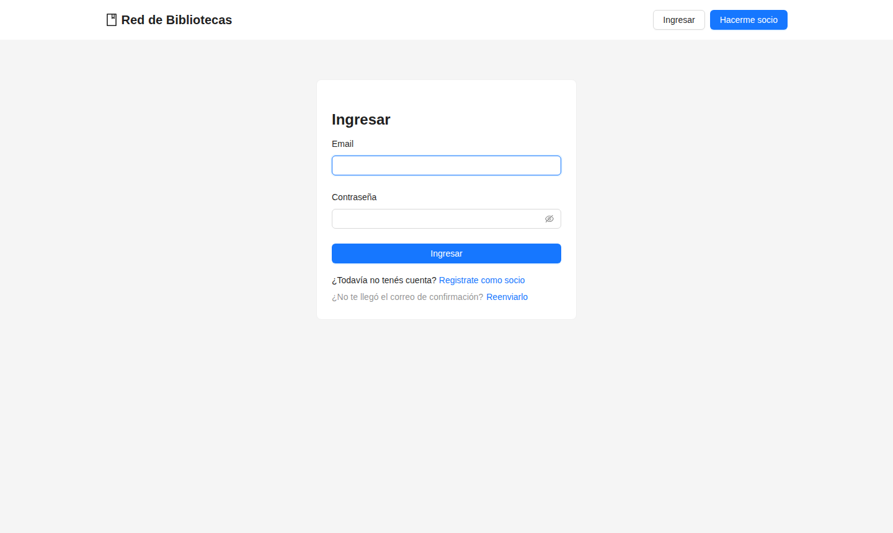

Según el tipo de cuenta, el sistema lleva a:

- **Socio**: su área personal, *Mis préstamos* (ver el [manual del socio](manual-socio.md)).
- **Administrador**: el panel de gestión (ver el [manual del administrador](manual-administrador.md)).

## 9. Mensajes de error al ingresar

| Mensaje | Qué significa | Qué hacer |
|---|---|---|
| *Todavía no confirmaste tu email* | No se abrió el enlace del correo de confirmación | Buscar el correo (o pedirlo de nuevo con **Reenviarlo**) |
| *Tu cuenta está esperando la aprobación de la biblioteca* | El email está confirmado, pero un administrador todavía no aprobó la cuenta | Esperar el correo de aprobación |
| *Email o contraseña incorrectos* | Algún dato está mal escrito | Revisar los datos |

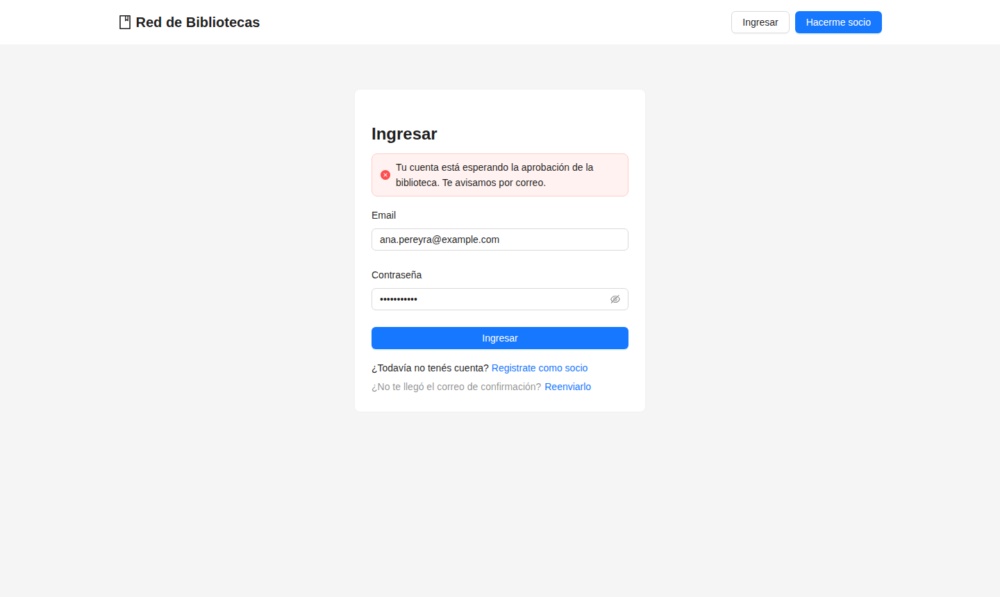

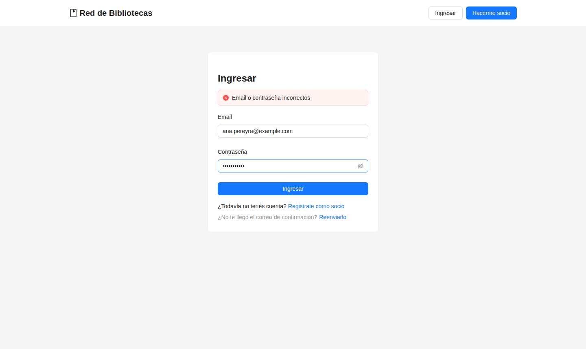

Si se entra a una dirección que no existe, el sistema muestra *Página no encontrada* con un
botón para volver al inicio:

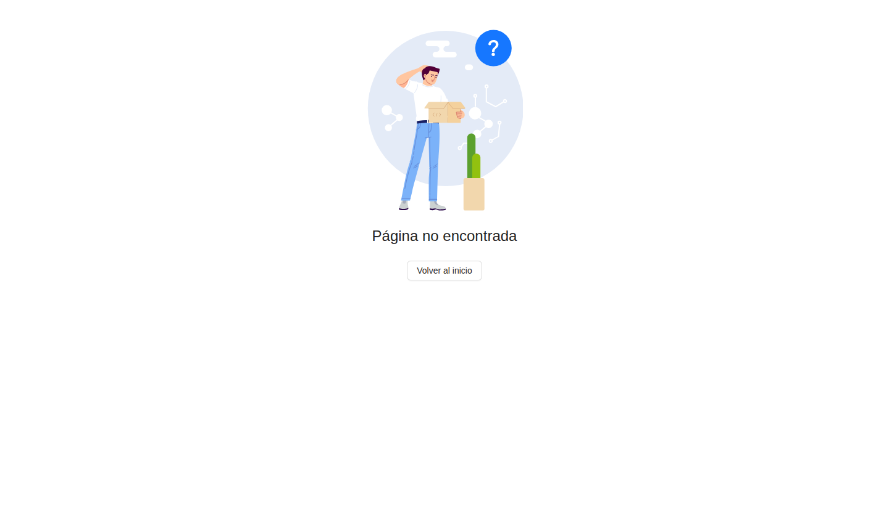
