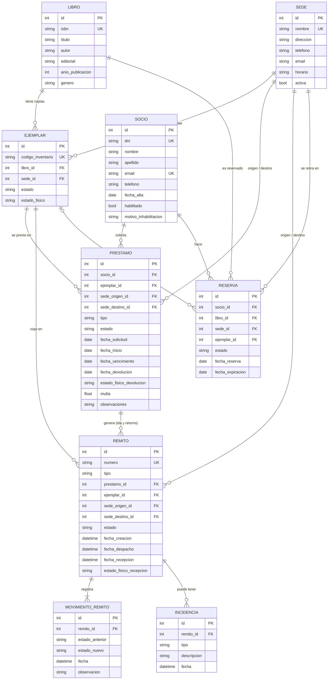
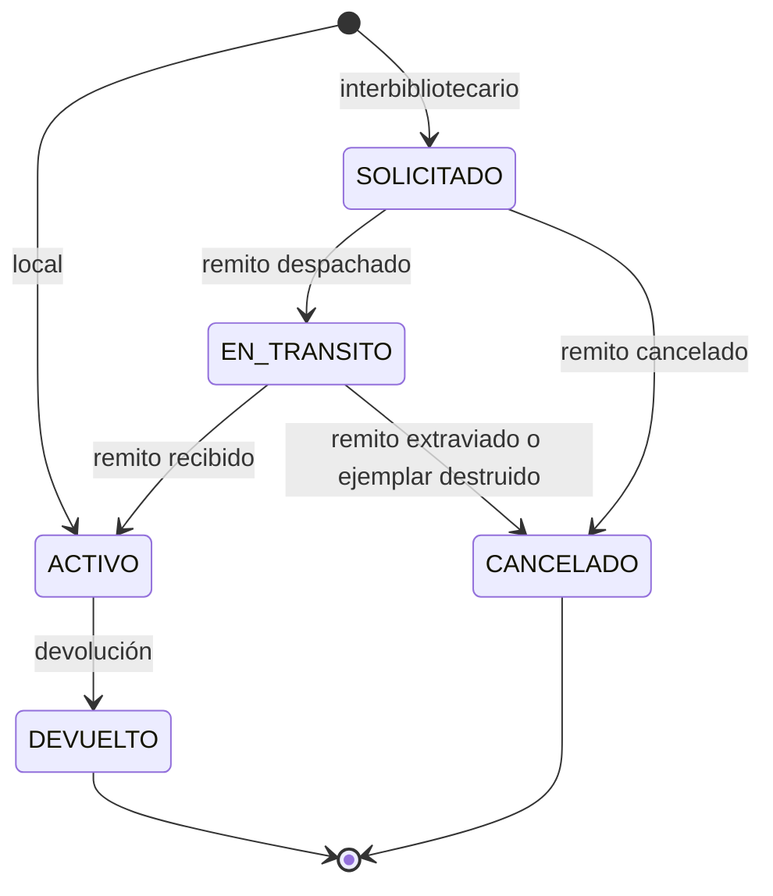
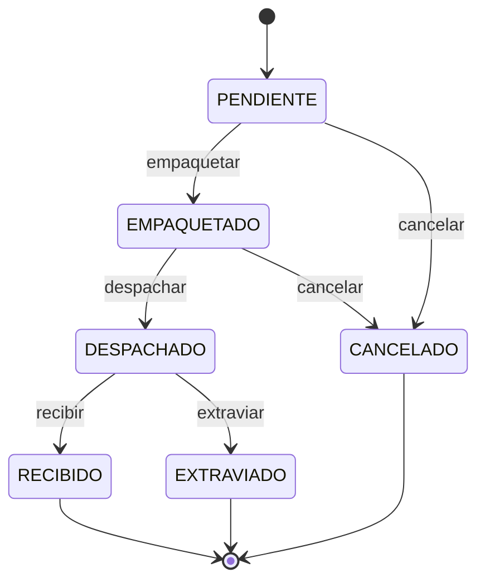
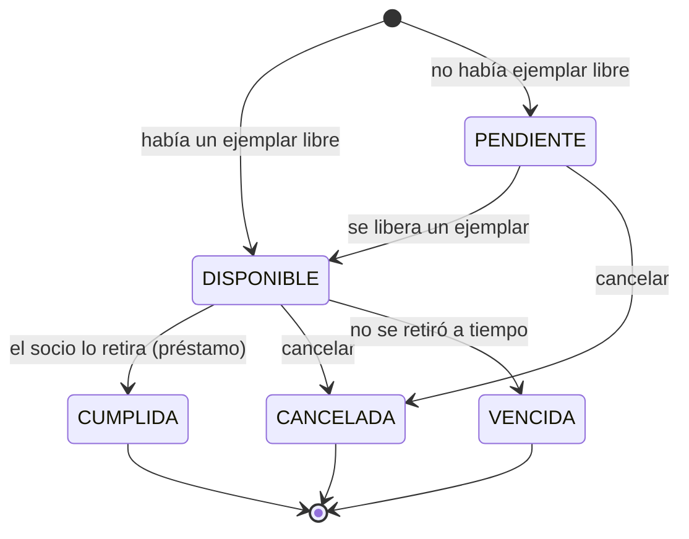

# Modelo de datos

El modelo se definió a partir de la consigna (Tema 1) y del dominio de bibliotecas. Las tablas se
generan con SQLAlchemy y se versionan con Alembic (`alembic/versions/0001_esquema_inicial.py`).

## Diagrama entidad-relación

## Decisiones de modelado

**Libro y Ejemplar están separados.** El libro es la obra del catálogo (lo que se busca y se
reserva) y el ejemplar es la copia física (lo que se presta y viaja). Así un mismo libro puede
tener varias copias en distintas sedes, y la disponibilidad se calcula por ejemplar.

**El ejemplar pertenece a una sede fija.** `ejemplares.sede_id` es la sede dueña y no cambia
cuando el ejemplar viaja. Dónde está físicamente se deduce del préstamo y del remito. Esto es lo
que permite validar que "no se prestan ejemplares que no pertenezcan a la sede de origen".

**El préstamo guarda origen y destino.** En un préstamo local las dos sedes coinciden. En uno
interbibliotecario, el origen es la sede dueña del ejemplar y el destino es donde lo retira el
socio. El campo `tipo` se deriva de esa comparación al crearlo.

**Un préstamo interbibliotecario tiene dos remitos.** El de ida (origen → destino) y el de
retorno (destino → origen). Se modelan con la misma tabla y el campo `tipo` (IDA / RETORNO).
El remito repite `ejemplar_id` y las sedes aunque se podrían obtener del préstamo: en el de
retorno las sedes van invertidas, y así cada remito se puede leer solo.

**La trazabilidad es una tabla aparte.** `movimientos_remito` guarda cada cambio de estado con
estado anterior, nuevo, fecha y observación. El remito conserva solo el estado actual y las
fechas clave (despacho y recepción) para los reportes.

**Las incidencias son una tabla aparte.** Cuando un envío se extravía o el ejemplar llega dañado
o destruido, se registra una `incidencia` con su tipo (EXTRAVIO, DANIO, DESTRUCCION), una
descripción y la fecha. El remito ya guarda el estado físico de llegada, pero la tabla permite
listar todos los problemas de envío juntos, filtrarlos por sede o período, y agregar más de un
registro por remito si hiciera falta.

**La reserva es por libro, no por ejemplar.** El socio quiere "ese libro en esa sede", no una
copia en particular. El `ejemplar_id` se completa recién cuando se le aparta una copia.

**Bajas lógicas.** Sedes, socios y ejemplares no se borran: se marcan (`activa`, `habilitado`,
estado `BAJA`). Borrarlos rompería el historial de préstamos y los reportes.

## Restricciones

| Tabla | Restricción | Para qué |
|---|---|---|
| sedes | `nombre` único | Evitar sedes duplicadas |
| socios | `dni` único, `email` único | Evitar socios duplicados |
| libros | `isbn` único | Evitar duplicados en el catálogo |
| ejemplares | `codigo_inventario` único | Evitar ejemplares duplicados |
| remitos | `numero` único | Identificar cada remito (formato `R-000001`) |
| todas | claves foráneas `NOT NULL` | Integridad referencial |

Además de la restricción en la base, los servicios verifican los duplicados antes de insertar
para devolver un error claro (409) en lugar de un error de base de datos. La validación del
nombre de sede no distingue mayúsculas ("Centro" y "centro" se consideran iguales).

Los enums se guardan como texto (`native_enum=False`) y no como tipo `ENUM` de Postgres. Así
agregar un valor nuevo no requiere alterar un tipo en la base: por ejemplo, el estado físico
DESTRUIDO se agregó sin migración.

## Migraciones

| Revisión | Cambio |
|---|---|
| `0001` | Esquema inicial |
| `0002` | Tabla `incidencias` |
| `0003` | Extensión `unaccent` de Postgres, para buscar sin distinguir tildes |

## Estados de cada entidad

### Ejemplar (`estado`)

| Estado | Significado |
|---|---|
| DISPONIBLE | En su sede, se puede prestar |
| RESERVADO | Apartado para un socio con reserva |
| PRESTADO | En manos de un socio, o comprometido en un préstamo interbibliotecario por despachar |
| EN_TRANSITO | Viajando entre sedes, o devuelto esperando el remito de retorno |
| EN_REPARACION | Se devolvió o llegó dañado; no circula hasta marcarlo reparado |
| EXTRAVIADO | Se perdió en un envío |
| BAJA | Retirado del catálogo, o se devolvió o llegó destruido |

El estado físico (`estado_fisico`) es independiente: BUENO, REGULAR, DANADO o DESTRUIDO.

### Préstamo (`estado`)

### Remito (`estado`)

Solo el remito de ida se puede cancelar. El de retorno no: el ejemplar tiene que volver a su
sede. La implementación de estas transiciones se explica en [patrones-de-diseno.md](patrones-de-diseno.md).

### Reserva (`estado`)

## Campos calculados

Algunos datos no se guardan porque se derivan de otros:

| Dato | Cómo se obtiene |
|---|---|
| Días de atraso | `fecha de referencia - fecha_vencimiento` (`Prestamo.dias_atraso`) |
| Préstamo vencido | Activo y con días de atraso > 0 (`Prestamo.esta_vencido`) |
| Horas de tránsito | `fecha_recepcion - fecha_despacho` (`Remito.horas_en_transito`) |
| Nombre completo | `nombre + apellido` (`Socio.nombre_completo`) |
| Préstamos en curso de un socio | Préstamos en SOLICITADO, EN_TRANSITO o ACTIVO |

La multa sí se guarda (`prestamos.multa`) al registrar la devolución, para que no cambie si
después se modifica la política de multas.
