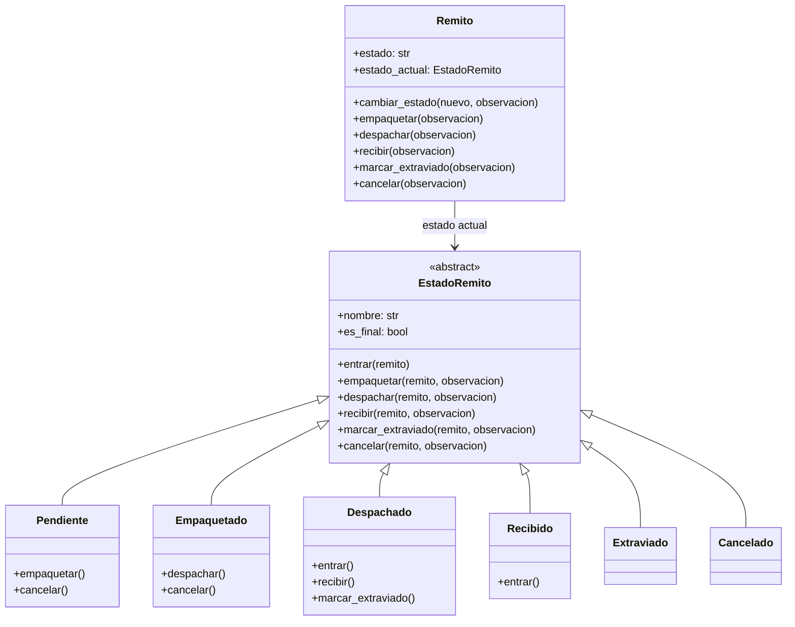
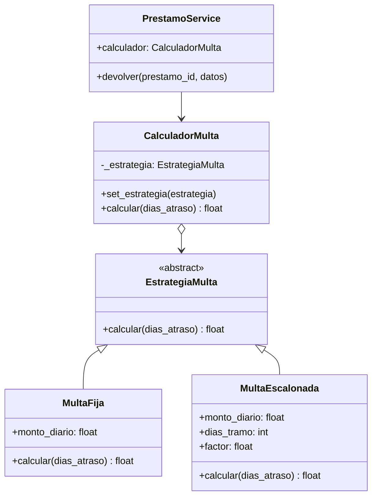
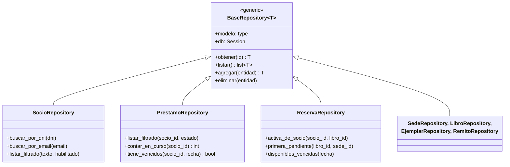

# Patrones de diseño

La consigna exige al menos dos patrones. Se aplicaron tres: **State**, **Strategy** y
**Repository**. Se evaluó también **Singleton** y se descartó; los motivos están al final.

| Patrón | Dónde | Problema que resuelve |
|---|---|---|
| State | `app/domain/estados_remito.py`, `app/models/remito.py` | Ciclo de vida del remito |
| Strategy | `app/domain/multas.py` | Cálculo de multas por atraso |
| Repository | `app/repositories/` | Separar el acceso a datos de la lógica de negocio |

---

## State: ciclo de vida del remito

### Problema

Un remito pasa por varios estados (pendiente, empaquetado, despachado, recibido, extraviado,
cancelado), y en cada uno solo algunas operaciones son válidas. Por ejemplo, no se puede
despachar algo que no se empaquetó, ni recibir algo que no se despachó. La consigna aclara que
"el ciclo de vida del remito y sus estados será evaluado críticamente".

Sin el patrón, cada operación necesitaría un condicional sobre el estado:

```python
def despachar(self):
    if self.estado == "EMPAQUETADO":
        self.estado = "DESPACHADO"
    elif self.estado in ("PENDIENTE", "RECIBIDO", "EXTRAVIADO", "CANCELADO"):
        raise Exception(...)
```

Ese bloque se repetiría en las cinco operaciones. Agregar un estado nuevo obligaría a revisar
todas, y es fácil olvidarse una combinación y permitir una transición inválida.

### Solución

Cada estado es una clase. El remito (el **contexto**) delega cada operación en su estado actual,
y el estado decide si la acepta y a qué estado pasa.



**Comportamiento por defecto en la clase base.** `EstadoRemito` implementa todas las operaciones
lanzando `TransicionInvalidaError`. Cada estado concreto sobrescribe solo las que admite:

```python
class EstadoRemito(ABC):
    def despachar(self, remito, observacion=None):
        self._rechazar("despachar")


class Empaquetado(EstadoRemito):
    nombre = "EMPAQUETADO"

    def despachar(self, remito, observacion=None):
        remito.cambiar_estado(Despachado(), observacion)
```

Así, una transición que no está programada es imposible: no hay que acordarse de prohibirla.
Los estados finales (Recibido, Extraviado, Cancelado) no sobrescriben ninguna operación.

**Gancho `entrar`.** Igual que en el ejemplo del semáforo visto en clase, cada estado puede
ejecutar algo al activarse. `Despachado.entrar` registra la fecha de despacho y `Recibido.entrar`
la de recepción. Con esas fechas se calcula el tiempo promedio de tránsito del reporte.

**Trazabilidad.** El cambio de estado pasa siempre por `Remito.cambiar_estado`, que además de
actualizar el estado agrega un `MovimientoRemito` al historial. Como no hay otra forma de cambiar
el estado, no puede haber un cambio sin registrar.

### Persistencia del estado

Los objetos estado no se guardan en la base. Se guarda el nombre (`remitos.estado = "DESPACHADO"`)
y la propiedad `Remito.estado_actual` reconstruye el objeto a partir de ese nombre:

```python
_ESTADOS = {cls.nombre: cls for cls in (Pendiente, Empaquetado, Despachado, Recibido, Extraviado, Cancelado)}

def estado_desde_nombre(nombre):
    return _ESTADOS[nombre]()
```

Los estados no tienen atributos propios, así que crear una instancia nueva cada vez no pierde
información.

### Reparto de responsabilidades

El patrón solo decide qué transiciones son válidas y deja registro de cada una. Los efectos
sobre otras entidades (el préstamo pasa a ACTIVO, el ejemplar a EN_TRANSITO, se asigna una
reserva) los coordina `RemitoService`, porque dependen de si el remito es de ida o de retorno y
de otras entidades que el estado no debería conocer.

### Cómo agregar un estado

Por ejemplo, un estado `EN_ADUANA` entre despachado y recibido:

1. Crear la clase `EnAduana(EstadoRemito)` con las operaciones que admite.
2. Cambiar `Despachado` para que su transición vaya a `EnAduana`.
3. Agregarla al diccionario `_ESTADOS`.

No hace falta tocar el remito, los servicios ni la base: la columna `estado` ya es texto.

### Tests

`tests/test_estados_remito.py` prueba el patrón sin base de datos: el recorrido completo, que
cada transición inválida se rechace sin modificar el remito, que los estados finales no acepten
ninguna operación y que el historial quede completo.

---

## Strategy: cálculo de multas

### Problema

Al devolver un préstamo con atraso se cobra una multa. La forma de calcularla es una política
que cambia entre bibliotecas o con el tiempo: monto fijo por día, escalonada, con tope, con días
de gracia, etc. Si el cálculo estuviera escrito dentro de la devolución, cada cambio de política
obligaría a tocar el proceso de préstamos.

### Solución

El cálculo se encapsula en una familia de clases intercambiables con la misma interfaz. El
servicio de préstamos usa la estrategia sin saber cuál es.



| Estrategia | Regla | Ejemplo con $500/día y 10 días de atraso |
|---|---|---|
| `MultaFija` | `días × monto` | 10 × 500 = **$5000** |
| `MultaEscalonada` | Primeros 7 días a monto base, desde el 8.° al doble | 7 × 500 + 3 × 1000 = **$6500** |

### Quién elige la estrategia

Como explica el apunte (16.5.1), la diferencia clave entre State y Strategy es **quién decide el
cambio**. En State, el propio estado decide a qué estado pasa. En Strategy, la elige alguien de
afuera. Acá la elige la configuración: la variable `MULTA_ESTRATEGIA` (`fija` o `escalonada`)
se lee al crear el servicio y `crear_estrategia` devuelve la clase correspondiente.

```python
self.calculador = CalculadorMulta(
    crear_estrategia(settings.multa_estrategia, settings.multa_monto_diario)
)
```

`PrestamoService` también acepta un `calculador` por parámetro, lo que permite usar otra
estrategia sin tocar la configuración (por ejemplo, en un test).

### Por qué no un diccionario de funciones

El apunte muestra que Strategy también se puede implementar con funciones en un diccionario
(16.6). Se eligieron clases porque las estrategias tienen parámetros propios (`monto_diario`,
`dias_tramo`, `factor`) y con una clase quedan encapsulados junto al cálculo. Con funciones
habría que pasarlos en cada llamada o usar clausuras.

### Cómo agregar una estrategia

1. Crear una subclase de `EstrategiaMulta` que implemente `calcular`.
2. Registrarla con un nombre en `crear_estrategia`.
3. Configurar `MULTA_ESTRATEGIA` con ese nombre.

### Tests

`tests/test_multas.py` prueba cada estrategia por separado, el cambio de estrategia en tiempo de
ejecución con `set_estrategia` y la creación por nombre. `tests/test_prestamos.py` verifica que
la devolución con atraso aplique la multa.

---

## Repository: acceso a datos

### Problema

Los servicios necesitan consultar y guardar entidades. Si cada servicio armara sus consultas con
SQLAlchemy directamente, la lógica de negocio quedaría mezclada con detalles de persistencia, y
las mismas consultas se repetirían en varios lugares (por ejemplo, "préstamos en curso de un
socio").

### Solución

Es la evolución del patrón DAO visto en clase (13.10): una clase por entidad que concentra su
acceso a datos. Una clase genérica resuelve las operaciones comunes y cada repositorio concreto
agrega sus consultas.



Cada repositorio concreto solo indica su modelo y hereda el resto:

```python
class SocioRepository(BaseRepository[Socio]):
    modelo = Socio

    def buscar_por_dni(self, dni):
        return self.db.scalar(select(Socio).where(Socio.dni == dni))
```

### Regla: el repositorio no hace commit

Los repositorios solo hacen `flush` (envían los cambios a la base dentro de la transacción) y el
**servicio** decide cuándo confirmar. Esto importa porque una operación de negocio toca varias
entidades. Por ejemplo, solicitar un préstamo interbibliotecario crea el préstamo, cambia el
estado del ejemplar, genera el remito y cierra la reserva. Si un repositorio confirmara por su
cuenta y después fallara una validación, quedaría la mitad de la operación guardada. Con un solo
commit al final del servicio, la operación entera se confirma o se descarta (unidad de trabajo,
14.3.3 del apunte).

### Beneficios

- Los servicios se leen como reglas de negocio, sin SQL.
- Cada consulta está en un solo lugar.
- Cambiar una consulta (por ejemplo, para optimizarla) no afecta a los servicios.

---

## Singleton: evaluado y descartado

El apunte presenta Singleton con el ejemplo de la conexión a la base de datos (15.3.2). Se
analizó para este proyecto y se decidió no aplicarlo:

1. **El engine ya es único.** `app/database.py` crea el `engine` de SQLAlchemy una vez, al
   importarse el módulo, y Python carga cada módulo una sola vez por proceso. El engine además
   administra un pool de conexiones. Envolverlo en un Singleton no agrega nada.

2. **La sesión no debe ser única.** La sesión de SQLAlchemy no es thread-safe y FastAPI atiende
   varias peticiones en paralelo. Con una sesión compartida, dos peticiones simultáneas mezclarían
   sus transacciones: el commit de una confirmaría cambios a medio hacer de la otra, y un error
   en una revertiría la otra. Por eso `get_db()` abre una sesión por petición y la cierra al
   terminar.

3. **Dificulta los tests.** Un Singleton es estado global. Con inyección de dependencias
   (`Depends(get_db)`), los tests reemplazan la sesión por una de prueba que se revierte al final
   de cada test, sin modificar el código de la aplicación.

El propio apunte señala estos problemas en 15.5.1 (acoplamiento global, dificultad para
testear, concurrencia). Entre las alternativas de 15.5.2 propone "considerar inyección de
dependencias en lugar de acceso global" y "preferir el enfoque de módulo en Python": son
exactamente las dos que se usaron (sesión inyectada por petición y engine a nivel de módulo).

---

## Otros recursos de POO utilizados

Sin ser patrones de diseño, el código usa los temas de la materia:

| Tema | Dónde |
|---|---|
| Clases abstractas (`ABC`, `@abstractmethod`) | `EstadoRemito`, `EstrategiaMulta` |
| Herencia y polimorfismo | Estados del remito, estrategias de multa, repositorios |
| Encapsulamiento y métodos de negocio en la entidad | `Socio.inhabilitar()`, `Sede.dar_de_baja()`, `Ejemplar.liberar()`, `Prestamo.activar()` |
| Propiedades (`@property`) | `Socio.nombre_completo`, `Ejemplar.esta_disponible`, `Remito.horas_en_transito` |
| Métodos mágicos | `__str__` en las entidades |
| Composición | `CalculadorMulta` contiene una estrategia; `Remito` contiene sus movimientos |
| Excepciones propias con jerarquía | `app/exceptions.py` |
