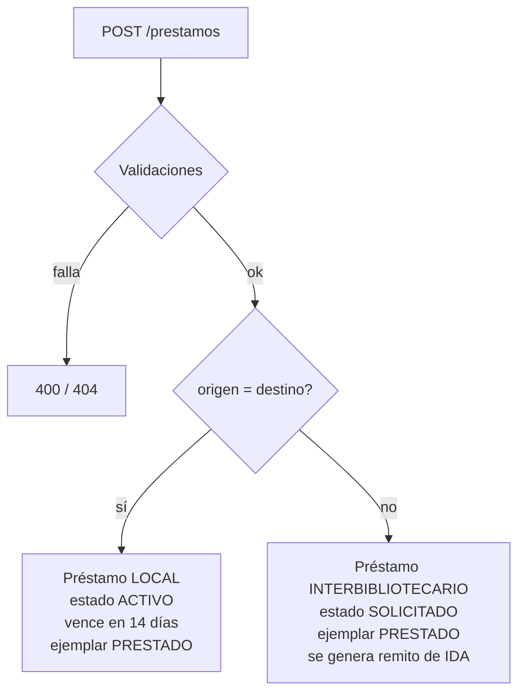
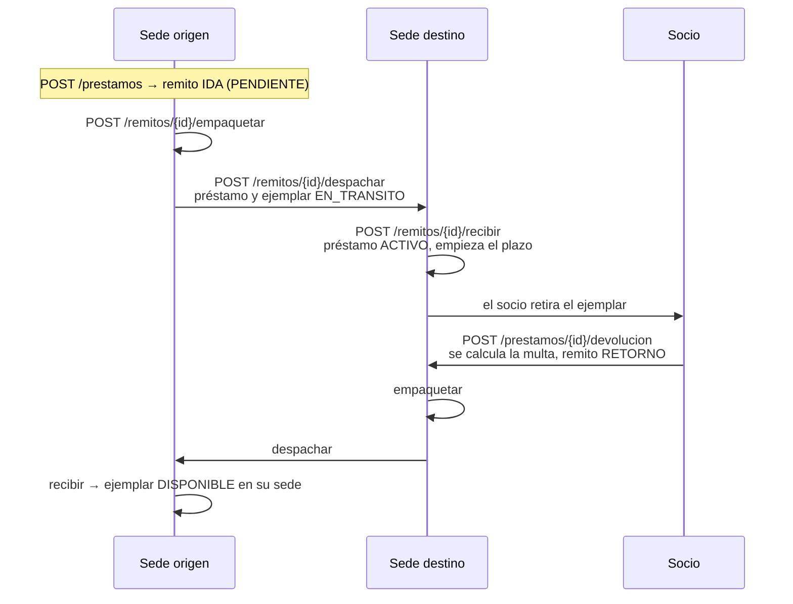
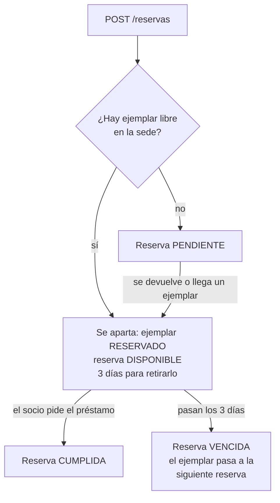
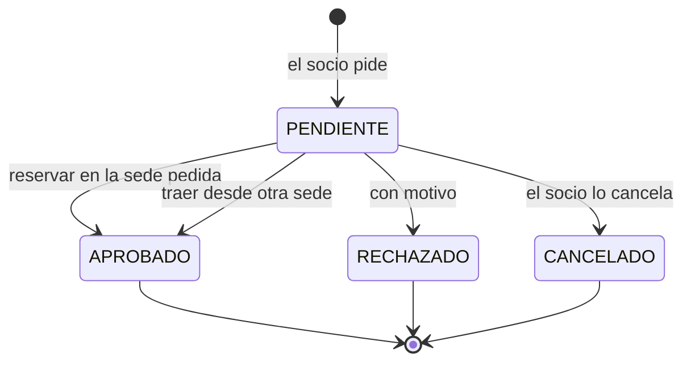

# Procesos y reglas de negocio

Este documento recorre cada punto de la consigna (Tema 1) e indica cómo se resolvió, qué
endpoints intervienen, dónde está la lógica y qué test lo verifica.

## Procesos obligatorios

### 1. Administrar sedes

Alta, modificación, consulta y baja/alta de sedes con dirección, teléfono, email, horario y
estado activa.

- Endpoints: `GET/POST /sedes`, `GET/PUT /sedes/{id}`, `PATCH /sedes/{id}/baja`, `PATCH /sedes/{id}/alta`
- Lógica: `SedeService`
- La baja es lógica (`activa = false`): la sede sigue existiendo para el historial y los reportes.
  Se puede volver a activar.

### 2. Administrar socios

Alta, modificación, consulta (búsqueda por nombre, apellido o DNI) e inhabilitación con motivo.

- Endpoints: `GET/POST /socios`, `GET/PUT /socios/{id}`, `PATCH /socios/{id}/inhabilitar`, `PATCH /socios/{id}/habilitar`
- Lógica: `SocioService`

### 3. Catálogo de libros y ejemplares

El libro es la obra (ISBN, título, autor) y el ejemplar es la copia física, con su sede y código
de inventario.

- Endpoints: `GET/POST /libros`, `GET/PUT /libros/{id}`, `GET/POST /ejemplares`, `GET /ejemplares/{id}`,
  `PATCH /ejemplares/{id}/baja`, `PATCH /ejemplares/{id}/reparado`
- Lógica: `CatalogoService`
- Un ejemplar solo se puede dar de baja si está disponible o en reparación (no si está prestado o
  viajando).

### 4. Solicitudes de préstamo local e interbibliotecario

Se indican socio, ejemplar, sede origen y sede destino. El tipo se deduce de las sedes.

- Lógica: `PrestamoService.solicitar`
- Si el ejemplar estaba apartado por una reserva del mismo socio, la reserva pasa a CUMPLIDA.
- En el interbibliotecario el plazo empieza a correr cuando el ejemplar llega a la sede destino,
  no al pedirlo: el socio no debería perder días mientras el libro viaja.
- Tests: `test_prestamo_local_queda_activo`, `test_circuito_interbibliotecario_completo`

### 5. Empaquetar, despachar y recibir con remito y trazabilidad

Cada préstamo interbibliotecario genera un remito de ida al solicitarse y uno de retorno al
devolverse. El remito avanza por estados y cada cambio queda registrado con fecha y observación.

- Lógica: `RemitoService` (efectos sobre préstamo y ejemplar) y el patrón State
  (`app/domain/estados_remito.py`) para las transiciones. Ver [patrones-de-diseno.md](patrones-de-diseno.md).
- Trazabilidad: `GET /remitos/{id}` o `GET /remitos/numero/{numero}` devuelven el remito con su
  historial completo (`movimientos`).
- Situaciones excepcionales:
  - **Cancelar** (solo el de ida, antes de despachar): se cancela el préstamo y el ejemplar
    vuelve a estar disponible.
  - **Extraviar** (solo despachado): el ejemplar queda EXTRAVIADO y, si era el de ida, el préstamo
    se cancela. Se registra una incidencia.
  - **Recibir con daño o destruido**: ver [revisión del estado de recepción](#revisión-del-estado-de-recepción).
- Tests: `test_recorrido_completo`, `test_cancelar_remito_libera_ejemplar`,
  `test_extravio_cancela_prestamo`, `test_remito_de_retorno_no_se_cancela`,
  `test_flujo_interbibliotecario_por_api`

### 6. Consultar disponibilidad

`GET /libros/{id}/disponibilidad` devuelve, para cada sede activa que tiene ese libro, cuántos
ejemplares hay, cuántos están disponibles y sus códigos. Los ejemplares dados de baja no cuentan.

- Lógica: `CatalogoService.disponibilidad`
- También: `GET /ejemplares?libro_id=&sede_id=&estado=` y el reporte de disponibilidad por sede.

### Proceso de vencimientos

Hay reglas que dependen del paso del tiempo y no de una acción del personal: una reserva que no
se retiró a tiempo y un préstamo que acumula demasiado atraso. Las resuelve
`ProcesoVencimientos` (`app/services/proceso_service.py`):

1. Vence las reservas listas para retirar cuyo plazo pasó, y ofrece el ejemplar a la siguiente.
2. Inhabilita a los socios con algún préstamo vencido hace más de `DIAS_ATRASO_INHABILITACION`
   días (30 por defecto).
3. Avisa a los socios: una vez cuando faltan `DIAS_AVISO_VENCIMIENTO` días o menos (2 por
   defecto) y otra cuando el préstamo ya venció. Cada aviso sale una sola vez por préstamo.

La API lo ejecuta sola al arrancar y después cada `INTERVALO_PROCESO_MINUTOS` (60 por defecto).
También se puede correr en el momento con `POST /procesos/vencimientos` o con el botón
**Procesar vencimientos** de la pantalla de inicio.

### Multa y atraso a la fecha

La multa se guarda al registrar la devolución. Mientras el préstamo sigue activo y vencido, cada
préstamo informa `dias_atraso_actual` y `multa_actual` (la multa que se cobraría si se devolviera
hoy), calculadas con la misma estrategia que la devolución. El frontend las muestra en la tabla de
préstamos, en el modal de devolución y en la consulta del socio.

### 7. Gestionar reservas

Un socio reserva un libro en una sede.

- Endpoints: `GET/POST /reservas`, `GET /reservas/{id}`, `POST /reservas/{id}/cancelar`,
  `POST /reservas/procesar-vencidas`
- Lógica: `ReservaService`
- Las reservas pendientes se atienden por orden de llegada. Cada vez que un ejemplar vuelve a
  estar disponible (devolución local, retorno recibido, reparación, cancelación o vencimiento de
  otra reserva), se asigna a la primera reserva que espera ese libro en esa sede.
- Un ejemplar reservado solo lo puede llevar el socio que lo reservó.
- Tests: todo `tests/test_reservas.py`

### 8. Devoluciones y estado físico

`POST /prestamos/{id}/devolucion` con el estado físico (BUENO, REGULAR, DANADO), observaciones y
opcionalmente la fecha (por defecto, hoy). También se acepta DESTRUIDO.

- Lógica: `PrestamoService.devolver`
- Se calcula la multa (patrón Strategy) y queda guardada en el préstamo con su detalle:
  - atraso de 1 a 7 días: $500 por día;
  - atraso de 8 días o más: 7 días a $500 y los siguientes a $1.000;
  - si se devuelve dañado se suman $5.000, y si se devuelve destruido, $20.000.
- Préstamo local: el ejemplar vuelve a DISPONIBLE (o a EN_REPARACION si volvió dañado) y se
  ofrece a la primera reserva pendiente.
- Préstamo interbibliotecario: se genera el remito de retorno hacia la sede de origen.
- Si se devuelve DESTRUIDO, el ejemplar se da de baja y no se genera remito de retorno: no tiene
  sentido enviar de vuelta un ejemplar inservible.
- Tests: `test_devolucion_en_termino_sin_multa`, `test_devolucion_con_atraso_genera_multa`,
  `test_devolucion_danada_con_atraso_suma_las_dos_multas`, `test_devolucion_destruida_en_termino_cobra_solo_el_cargo`,
  `test_devolucion_danado_pasa_a_reparacion`, `test_no_se_devuelve_dos_veces`

## Validaciones de formato

Antes de llegar a las reglas de negocio, cada dato se controla en su DTO
(`app/schemas/validaciones.py`). Si algo no cumple, la API responde 422 con el motivo de cada
campo y no se ejecuta nada. El frontend aplica las mismas reglas (`frontend/src/utiles/reglas.js`)
para avisar mientras se completa el formulario.

| Dato | Regla | Ejemplos válidos |
|---|---|---|
| DNI | 7 u 8 dígitos. Se aceptan puntos o espacios, que se quitan | `30111222`, `30.111.222`, `7654321` |
| Nombre y apellido | 2 a 50 caracteres. Solo letras (con tildes y ñ), separadas por un espacio, apóstrofe o guion. Se quitan los espacios de más | `Li`, `María de los Ángeles`, `O'Brien`, `Pérez-Gil` |
| Teléfono (socio y sede) | Opcional. Solo dígitos, entre 6 y 15 | `3514000001` |
| Email | Formato de email, hasta 120 caracteres | `ana@mail.com` |
| ISBN | ISBN-10 o ISBN-13 con el dígito verificador correcto. Se aceptan guiones, que se quitan | `9789500728997`, `978-950-07-2899-7`, `080442957X` |
| Año de publicación | Opcional. Entre 1400 y el año actual | `1963` |
| Textos (título, autor, dirección, motivo, etc.) | Obligatorios donde corresponde, con largo mínimo y máximo. Se quitan los espacios de más | |

Las respuestas de la API no vuelven a validar el formato: un dato guardado antes de estas reglas,
o cargado a mano en la base, se sigue mostrando sin romper la pantalla.

## Validaciones de negocio

| Validación de la consigna | Dónde se controla | Test |
|---|---|---|
| No prestar ejemplares no disponibles | `PrestamoService.solicitar` | `test_no_presta_ejemplar_no_disponible`, `test_ejemplar_reservado_solo_lo_retira_quien_reservo` |
| No prestar a socios inhabilitados | `SocioService.obtener_habilitado`, usado al prestar y reservar. La inhabilitación puede ser manual (con motivo) o automática por atraso | `test_no_presta_a_socio_inhabilitado`, `test_regla_de_negocio_devuelve_400`, `test_inhabilitado_por_atraso_no_puede_pedir_ni_reservar` |
| Controlar fechas de vencimiento | `Prestamo.activar` calcula el vencimiento; `PrestamoService` bloquea nuevos préstamos si hay vencidos y cobra multa al devolver tarde | `test_socio_con_prestamo_vencido_no_puede_pedir_otro`, `test_devolucion_con_atraso_genera_multa` |
| Trazabilidad del remito en todo el trayecto | `Remito.cambiar_estado` registra cada cambio en `movimientos_remito` | `test_recorrido_completo`, `test_circuito_interbibliotecario_completo` |
| Evitar duplicados (socios, catálogo, ejemplares) | Restricciones `UNIQUE` en la base y verificación previa en cada servicio | `test_duplicados_devuelven_409` |
| No prestar ejemplares de otra sede que la de origen | `PrestamoService.solicitar` | `test_ejemplar_debe_ser_de_la_sede_origen` |
| No iniciar préstamos, reservas ni envíos con una sede dada de baja | `SedeService.obtener_activa` al prestar y reservar; `RemitoService.despachar` al iniciar el envío | `test_no_presta_con_sede_dada_de_baja`, `test_no_reserva_en_sede_dada_de_baja`, `test_no_se_despacha_si_la_sede_se_dio_de_baja` |

### Reglas agregadas por el grupo

La consigna pide investigar el dominio y definir las reglas necesarias. Además de las anteriores
se agregaron:

| Regla | Motivo | Test |
|---|---|---|
| Máximo de préstamos en curso por socio (3) | Práctica habitual en bibliotecas; evita que un socio acapare material | `test_maximo_de_prestamos` |
| Un socio con préstamos vencidos no puede pedir otro | Consecuencia directa de controlar los vencimientos. No cambia el estado del socio: es una traba mientras no devuelva (en pantalla, "Con vencidos") | `test_socio_con_prestamo_vencido_no_puede_pedir_otro` |
| Inhabilitación automática: si un préstamo pasa más de 30 días vencido sin devolverse, el socio queda inhabilitado con el motivo cargado ("Préstamo N° X (título) vencido hace N días") | Un atraso largo es más grave que uno corto: además de la multa, se le impide reservar. Se rehabilita a mano cuando regulariza | `tests/test_inhabilitacion.py` |
| El remito de retorno se despacha aunque una sede esté de baja | Si se bloqueara, el ejemplar quedaría varado en otra sede | - |
| Solo se cancela el remito de ida | El de retorno siempre tiene que completarse | `test_remito_de_retorno_no_se_cancela` |
| Un ejemplar dañado no circula hasta repararlo | No prestar material en mal estado | `test_devolucion_danado_pasa_a_reparacion` |
| Un ejemplar destruido se da de baja; si llega destruido en el envío de ida, se cancela el préstamo | El socio no puede retirar un ejemplar inservible | `test_recepcion_destruido_cancela_prestamo_y_da_de_baja`, `test_devolucion_destruido_no_genera_retorno` |
| Una sola reserva activa por socio y libro | Evitar reservas duplicadas | `test_no_duplica_reserva_activa` |
| No se reserva un libro que la sede no tiene | La reserva nunca podría cumplirse | `test_no_reserva_libro_sin_ejemplares_en_la_sede` |

## Reportes

La consigna pide al menos cuatro reportes no triviales. Se implementaron los seis sugeridos
(`ReporteService`, tests en `tests/test_reportes.py`).

| Endpoint | Contenido | Qué lo hace no trivial |
|---|---|---|
| `GET /reportes/prestamos-activos` | Préstamos activos (con marca de vencido) y remitos en viaje con horas transcurridas | Cruza préstamos, ejemplares, libros, socios y remitos |
| `GET /reportes/vencidos-multas?fecha=` | Por socio: préstamos vencidos con días de atraso, multas cobradas, multas pendientes estimadas y total | Calcula multas a una fecha con las mismas estrategias que la devolución y agrupa por socio |
| `GET /reportes/libros-mas-solicitados?desde=&hasta=&limite=` | Ranking de libros en préstamos inter-sede | Agregación con `GROUP BY` y filtro por período |
| `GET /reportes/disponibilidad-sedes` | Por sede: títulos distintos, ejemplares por estado y porcentaje disponible | Agregación por sede y estado; incluye sedes sin ejemplares |
| `GET /reportes/envios?desde=&hasta=` | Recibidos sin problemas, con daño, destruidos, extraviados, cancelados, en curso; tasa de éxito e incidencias | Clasifica remitos por resultado; los cancelados no cuentan para la tasa porque no viajaron |
| `GET /reportes/movimientos-sedes?desde=&hasta=` | Por par origen-destino: envíos, recibidos, incidencias y tiempo promedio de tránsito | Agrupa por ruta y promedia `fecha_recepcion - fecha_despacho` |

## Usuarios, roles y pedidos

Además de lo que pide la consigna, el sistema distingue tres tipos de acceso. El detalle técnico
está en [arquitectura.md](arquitectura.md#seguridad).

| Quién | Qué ve |
|---|---|
| Cualquier persona, sin cuenta | El catálogo y en qué sedes hay ejemplares libres |
| Socio con cuenta | Sus préstamos, reservas, pedidos, historial de lectura y notificaciones; puede pedir libros |
| Administrador | Todo el panel de gestión |

### Alta de un socio

1. La persona se registra en `/registro` con DNI, nombre, apellido, email, teléfono opcional y
   contraseña (al menos 8 caracteres, con letras y números).
2. Le llega un correo con un enlace para confirmar el email. Hasta confirmarlo no puede
   ingresar; desde la pantalla de ingreso puede pedir que se lo reenvíen.
3. Al confirmar, los administradores reciben un aviso. La cuenta queda **esperando aprobación**
   y el socio, inhabilitado.
4. Un administrador la aprueba (el socio queda habilitado) o la rechaza con un motivo. En ambos
   casos al socio le llega un correo.

Reglas:

- Un email tiene una sola cuenta, y un DNI también.
- Si el DNI ya corresponde a un socio cargado por la biblioteca, el email tiene que coincidir con
  el registrado; en ese caso la cuenta se vincula a ese socio y no necesita aprobación.
- Los administradores no se registran: el primero se crea al arrancar con los datos de la
  configuración (`ADMIN_EMAIL`, `ADMIN_CONTRASENA`) y los demás los crea un administrador.

### Pedidos

El socio no reserva directamente: hace un **pedido** desde el catálogo eligiendo la sede donde
quiere retirar el libro. El pedido le llega al administrador, que decide cómo atenderlo:

| Decisión | Qué hace el sistema |
|---|---|
| Reservar | Crea una reserva en la sede pedida. Si hay un ejemplar libre queda apartado; si no, el socio entra en la lista de espera |
| Traer desde otra sede | Crea un préstamo interbibliotecario desde la sede elegida hasta la del pedido, con su remito |
| Rechazar | Guarda el motivo, que le llega al socio |

Reglas al pedir:

- El socio tiene que estar habilitado y la sede, activa.
- El libro tiene que tener al menos un ejemplar en circulación en la red (no dado de baja ni
  extraviado, en una sede activa).
- No puede tener otro pedido pendiente ni una reserva activa del mismo libro.

Reglas al resolver: solo se resuelven pedidos pendientes; para traerlo de otra sede, esa sede
tiene que ser distinta a la del pedido y tener un ejemplar disponible. Además valen todas las
reglas de reservas y préstamos (por ejemplo, el límite de préstamos activos).

- Lógica: `PedidoService` (`app/services/pedido_service.py`)
- Tests: `tests/test_pedidos.py`

## Procesos opcionales

De los cinco opcionales de la consigna se implementaron cuatro.

### Historial de lecturas

El socio lo ve en **Historial de lectura** (`GET /mi/historial`); el administrador, en la ficha
de cada socio (`GET /socios/{id}/historial`). Devuelve los préstamos ya devueltos, del más
reciente al más antiguo, con título, autor, tipo de préstamo, sede donde lo retiró, fechas,
días de atraso y multa. Está paginado.

- Lógica: `PrestamoService.historial_de_socio` y `PrestamoRepository.historial_de_socio`
- No requirió cambios en el modelo: el historial son los préstamos en estado DEVUELTO.
- Tests: `tests/test_historial.py`, `test_historial_por_api`

### Revisión del estado de recepción

Al recibir un remito (`POST /remitos/{id}/recibir`) se registra el resultado de revisar el
ejemplar. Junto con el extravío, cubre los tres casos que nombra la consigna: extravío, daño y
destrucción.

| Resultado | Incidencia | Ejemplar | Préstamo (remito de ida) |
|---|---|---|---|
| BUENO / REGULAR | - | PRESTADO (ida) o DISPONIBLE (retorno) | ACTIVO |
| DANADO | DANIO | PRESTADO (ida) o EN_REPARACION (retorno) | ACTIVO: el socio puede usarlo igual |
| DESTRUIDO | DESTRUCCION | BAJA | CANCELADO |
| Extraviado (`POST /remitos/{id}/extraviar`) | EXTRAVIO | EXTRAVIADO | CANCELADO |

- Las incidencias se consultan en `GET /incidencias?tipo=&sede_id=&desde=&hasta=` (paginado) y
  dentro del detalle de cada remito (`GET /remitos/{id}`).
- Lógica: `RemitoService.recibir` y `RemitoService.marcar_extraviado`
- Tests: `tests/test_incidencias.py`

### Envío de notificaciones

Cada aviso aparece en la campana del sistema y, si el usuario recibe correos, también le llega
por mail. Se implementó con el patrón Observer; la lista completa de avisos y cómo se envían
está en [patrones-de-diseno.md](patrones-de-diseno.md#observer-notificaciones).

| Para el socio | Para los administradores |
|---|---|
| Cuenta aprobada o rechazada | Nuevo socio para aprobar |
| Pedido aprobado (cómo se resolvió) o rechazado (motivo) | Nuevo pedido de un socio |
| Reserva lista para retirar | |
| El libro llegó a la sede (remito de ida recibido) | |
| El préstamo vence pronto / ya venció | |
| Quedó inhabilitado (con el motivo) | |

- Cada notificación se puede marcar como leída; la campana muestra cuántas quedan sin leer.
- Lógica: `app/services/eventos.py`, `app/services/notificaciones.py`, `NotificacionService`
- Tests: `tests/test_notificaciones.py`, `tests/test_cuentas.py`

### Inventario con códigos

Es el **recuento físico** de los estantes de una sede: se recorren los estantes leyendo el
código de cada ejemplar (con un lector de código de barras o a mano) y el sistema lo compara con
lo que debería estar ahí.

1. Un administrador **inicia** el inventario de una sede (uno en curso por sede a la vez).
2. Lee los códigos. Cada lectura responde en el momento:
   - **Encontrado**: el ejemplar es de esa sede y debería estar en el estante.
   - **Fuera de lugar**: existe pero no debería estar ahí (es de otra sede, figura prestado, en
     tránsito, extraviado o dado de baja).
   - **Desconocido**: el código no corresponde a ningún ejemplar.
   Un código repetido se avisa y no se cuenta dos veces; una lectura equivocada se puede deshacer.
3. Mientras está en curso, el informe se calcula en vivo y agrega los **faltantes**: ejemplares
   que deberían estar en el estante (disponibles, reservados o en reparación) y no se leyeron.
4. Al **cerrar**, el informe queda guardado como estaba en ese momento y no se aceptan más
   lecturas.

Con el informe se puede actuar: un faltante se marca como **extraviado** (deja de figurar como
disponible) y un ejemplar extraviado que apareció se marca como **recuperado** (vuelve a
circular y, si había reservas en espera, se le asigna a la primera).

Para leer con lector, la pantalla **Etiquetas** genera los códigos de barras (CODE128) de los
ejemplares filtrando por sede, libro o estado, listos para imprimir y pegar.

- Lógica: `InventarioService`, `CatalogoService.marcar_extraviado` y `recuperar`
- Tests: `tests/test_inventario.py`

### No implementado

Recomendaciones de lectura.
