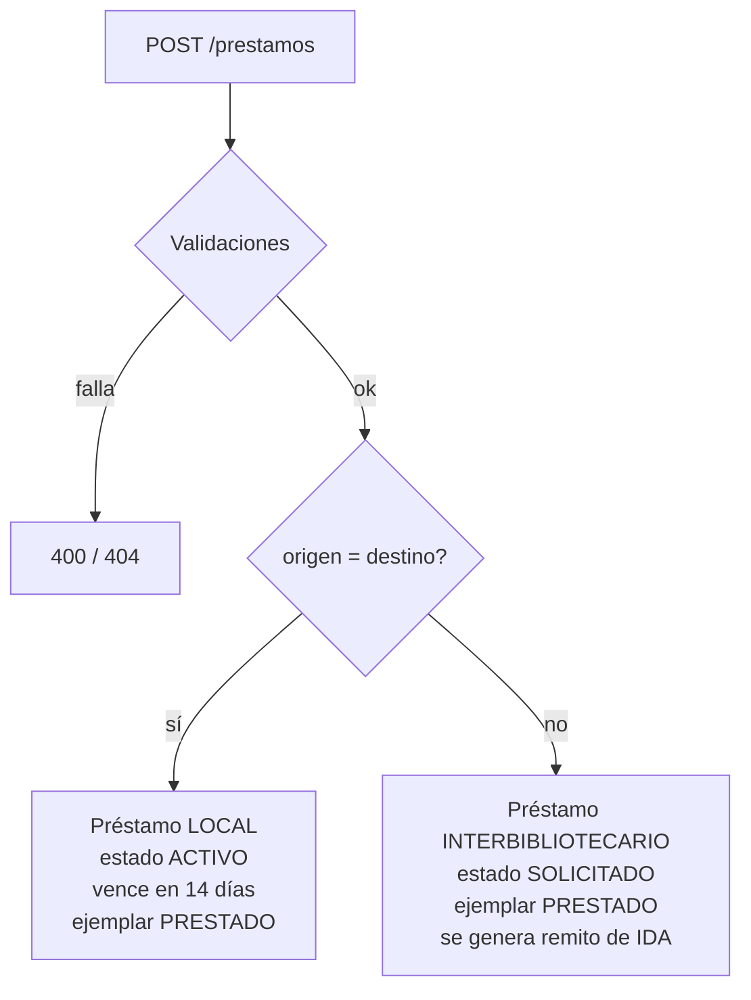
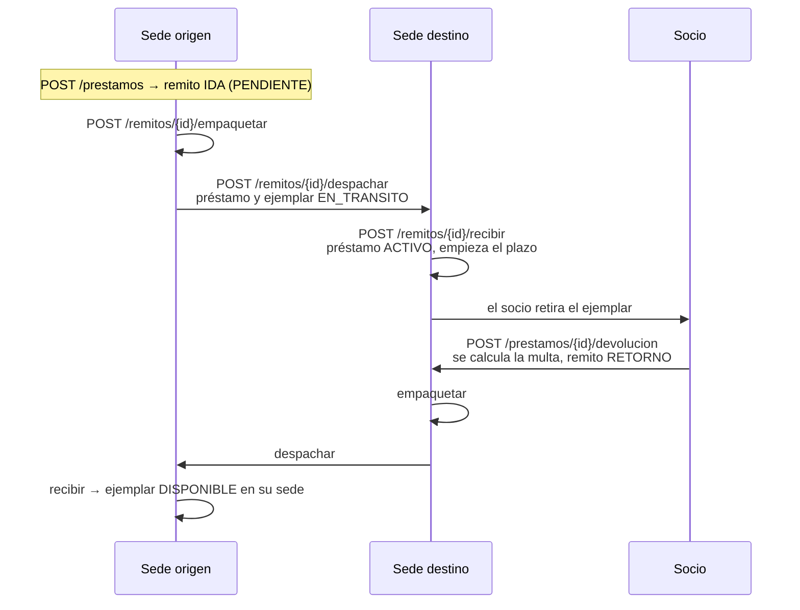
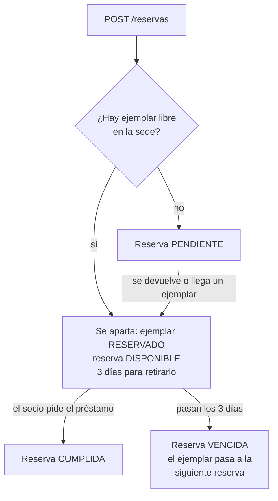

# Procesos y reglas de negocio

Este documento recorre cada punto de la consigna (Tema 1) e indica cómo se resolvió, qué
endpoints intervienen, dónde está la lógica y qué test lo verifica.

## Procesos obligatorios

### 1. Administrar sedes

Alta, modificación, consulta y baja/alta de sedes con dirección, teléfono, email, horario y
estado activa.

- Endpoints: `GET/POST /sedes`, `GET/PUT /sedes/{id}`, `PATCH /sedes/{id}/baja`, `PATCH /sedes/{id}/alta`
- Lógica: `SedeService`
- La baja es lógica (`activa = false`): la sede sigue existiendo para el historial y los reportes.
  Se puede volver a activar.

### 2. Administrar socios

Alta, modificación, consulta (búsqueda por nombre, apellido o DNI) e inhabilitación con motivo.

- Endpoints: `GET/POST /socios`, `GET/PUT /socios/{id}`, `PATCH /socios/{id}/inhabilitar`, `PATCH /socios/{id}/habilitar`
- Lógica: `SocioService`

### 3. Catálogo de libros y ejemplares

El libro es la obra (ISBN, título, autor) y el ejemplar es la copia física, con su sede y código
de inventario.

- Endpoints: `GET/POST /libros`, `GET/PUT /libros/{id}`, `GET/POST /ejemplares`, `GET /ejemplares/{id}`,
  `PATCH /ejemplares/{id}/baja`, `PATCH /ejemplares/{id}/reparado`
- Lógica: `CatalogoService`
- Un ejemplar solo se puede dar de baja si está disponible o en reparación (no si está prestado o
  viajando).

### 4. Solicitudes de préstamo local e interbibliotecario

Se indican socio, ejemplar, sede origen y sede destino. El tipo se deduce de las sedes.

- Lógica: `PrestamoService.solicitar`
- Si el ejemplar estaba apartado por una reserva del mismo socio, la reserva pasa a CUMPLIDA.
- En el interbibliotecario el plazo empieza a correr cuando el ejemplar llega a la sede destino,
  no al pedirlo: el socio no debería perder días mientras el libro viaja.
- Tests: `test_prestamo_local_queda_activo`, `test_circuito_interbibliotecario_completo`

### 5. Empaquetar, despachar y recibir con remito y trazabilidad

Cada préstamo interbibliotecario genera un remito de ida al solicitarse y uno de retorno al
devolverse. El remito avanza por estados y cada cambio queda registrado con fecha y observación.

- Lógica: `RemitoService` (efectos sobre préstamo y ejemplar) y el patrón State
  (`app/domain/estados_remito.py`) para las transiciones. Ver [patrones-de-diseno.md](patrones-de-diseno.md).
- Trazabilidad: `GET /remitos/{id}` o `GET /remitos/numero/{numero}` devuelven el remito con su
  historial completo (`movimientos`).
- Situaciones excepcionales:
  - **Cancelar** (solo el de ida, antes de despachar): se cancela el préstamo y el ejemplar
    vuelve a estar disponible.
  - **Extraviar** (solo despachado): el ejemplar queda EXTRAVIADO y, si era el de ida, el préstamo
    se cancela. Se registra una incidencia.
  - **Recibir con daño o destruido**: ver [revisión del estado de recepción](#revisión-del-estado-de-recepción).
- Tests: `test_recorrido_completo`, `test_cancelar_remito_libera_ejemplar`,
  `test_extravio_cancela_prestamo`, `test_remito_de_retorno_no_se_cancela`,
  `test_flujo_interbibliotecario_por_api`

### 6. Consultar disponibilidad

`GET /libros/{id}/disponibilidad` devuelve, para cada sede activa que tiene ese libro, cuántos
ejemplares hay, cuántos están disponibles y sus códigos. Los ejemplares dados de baja no cuentan.

- Lógica: `CatalogoService.disponibilidad`
- También: `GET /ejemplares?libro_id=&sede_id=&estado=` y el reporte de disponibilidad por sede.

### 7. Gestionar reservas

Un socio reserva un libro en una sede.

- Endpoints: `GET/POST /reservas`, `GET /reservas/{id}`, `POST /reservas/{id}/cancelar`,
  `POST /reservas/procesar-vencidas`
- Lógica: `ReservaService`
- Las reservas pendientes se atienden por orden de llegada. Cada vez que un ejemplar vuelve a
  estar disponible (devolución local, retorno recibido, reparación, cancelación o vencimiento de
  otra reserva), se asigna a la primera reserva que espera ese libro en esa sede.
- Un ejemplar reservado solo lo puede llevar el socio que lo reservó.
- Tests: todo `tests/test_reservas.py`

### 8. Devoluciones y estado físico

`POST /prestamos/{id}/devolucion` con el estado físico (BUENO, REGULAR, DANADO), observaciones y
opcionalmente la fecha (por defecto, hoy). También se acepta DESTRUIDO.

- Lógica: `PrestamoService.devolver`
- Se calcula la multa si hubo atraso (patrón Strategy) y queda guardada en el préstamo.
- Préstamo local: el ejemplar vuelve a DISPONIBLE (o a EN_REPARACION si volvió dañado) y se
  ofrece a la primera reserva pendiente.
- Préstamo interbibliotecario: se genera el remito de retorno hacia la sede de origen.
- Si se devuelve DESTRUIDO, el ejemplar se da de baja y no se genera remito de retorno: no tiene
  sentido enviar de vuelta un ejemplar inservible.
- Tests: `test_devolucion_en_termino_sin_multa`, `test_devolucion_con_atraso_genera_multa`,
  `test_devolucion_danado_pasa_a_reparacion`, `test_no_se_devuelve_dos_veces`

## Validaciones de negocio

| Validación de la consigna | Dónde se controla | Test |
|---|---|---|
| No prestar ejemplares no disponibles | `PrestamoService.solicitar` | `test_no_presta_ejemplar_no_disponible`, `test_ejemplar_reservado_solo_lo_retira_quien_reservo` |
| No prestar a socios inhabilitados | `SocioService.obtener_habilitado`, usado al prestar y reservar | `test_no_presta_a_socio_inhabilitado`, `test_regla_de_negocio_devuelve_400` |
| Controlar fechas de vencimiento | `Prestamo.activar` calcula el vencimiento; `PrestamoService` bloquea nuevos préstamos si hay vencidos y cobra multa al devolver tarde | `test_socio_con_prestamo_vencido_no_puede_pedir_otro`, `test_devolucion_con_atraso_genera_multa` |
| Trazabilidad del remito en todo el trayecto | `Remito.cambiar_estado` registra cada cambio en `movimientos_remito` | `test_recorrido_completo`, `test_circuito_interbibliotecario_completo` |
| Evitar duplicados (socios, catálogo, ejemplares) | Restricciones `UNIQUE` en la base y verificación previa en cada servicio | `test_duplicados_devuelven_409` |
| No prestar ejemplares de otra sede que la de origen | `PrestamoService.solicitar` | `test_ejemplar_debe_ser_de_la_sede_origen` |
| No iniciar préstamos, reservas ni envíos con una sede dada de baja | `SedeService.obtener_activa` al prestar y reservar; `RemitoService.despachar` al iniciar el envío | `test_no_presta_con_sede_dada_de_baja`, `test_no_reserva_en_sede_dada_de_baja`, `test_no_se_despacha_si_la_sede_se_dio_de_baja` |

### Reglas agregadas por el grupo

La consigna pide investigar el dominio y definir las reglas necesarias. Además de las anteriores
se agregaron:

| Regla | Motivo | Test |
|---|---|---|
| Máximo de préstamos en curso por socio (3) | Práctica habitual en bibliotecas; evita que un socio acapare material | `test_maximo_de_prestamos` |
| Un socio con préstamos vencidos no puede pedir otro | Consecuencia directa de controlar los vencimientos | `test_socio_con_prestamo_vencido_no_puede_pedir_otro` |
| El remito de retorno se despacha aunque una sede esté de baja | Si se bloqueara, el ejemplar quedaría varado en otra sede | - |
| Solo se cancela el remito de ida | El de retorno siempre tiene que completarse | `test_remito_de_retorno_no_se_cancela` |
| Un ejemplar dañado no circula hasta repararlo | No prestar material en mal estado | `test_devolucion_danado_pasa_a_reparacion` |
| Un ejemplar destruido se da de baja; si llega destruido en el envío de ida, se cancela el préstamo | El socio no puede retirar un ejemplar inservible | `test_recepcion_destruido_cancela_prestamo_y_da_de_baja`, `test_devolucion_destruido_no_genera_retorno` |
| Una sola reserva activa por socio y libro | Evitar reservas duplicadas | `test_no_duplica_reserva_activa` |
| No se reserva un libro que la sede no tiene | La reserva nunca podría cumplirse | `test_no_reserva_libro_sin_ejemplares_en_la_sede` |

## Reportes

La consigna pide al menos cuatro reportes no triviales. Se implementaron los seis sugeridos
(`ReporteService`, tests en `tests/test_reportes.py`).

| Endpoint | Contenido | Qué lo hace no trivial |
|---|---|---|
| `GET /reportes/prestamos-activos` | Préstamos activos (con marca de vencido) y remitos en viaje con horas transcurridas | Cruza préstamos, ejemplares, libros, socios y remitos |
| `GET /reportes/vencidos-multas?fecha=` | Por socio: préstamos vencidos con días de atraso, multas cobradas, multas pendientes estimadas y total | Calcula multas a una fecha con la estrategia vigente y agrupa por socio |
| `GET /reportes/libros-mas-solicitados?desde=&hasta=&limite=` | Ranking de libros en préstamos inter-sede | Agregación con `GROUP BY` y filtro por período |
| `GET /reportes/disponibilidad-sedes` | Por sede: títulos distintos, ejemplares por estado y porcentaje disponible | Agregación por sede y estado; incluye sedes sin ejemplares |
| `GET /reportes/envios?desde=&hasta=` | Recibidos sin problemas, con daño, destruidos, extraviados, cancelados, en curso; tasa de éxito e incidencias | Clasifica remitos por resultado; los cancelados no cuentan para la tasa porque no viajaron |
| `GET /reportes/movimientos-sedes?desde=&hasta=` | Por par origen-destino: envíos, recibidos, incidencias y tiempo promedio de tránsito | Agrupa por ruta y promedia `fecha_recepcion - fecha_despacho` |

## Procesos opcionales

De los cinco opcionales de la consigna se implementaron dos.

### Historial de lecturas

`GET /socios/{id}/historial` devuelve los préstamos ya devueltos del socio, del más reciente al
más antiguo, con título, autor, tipo de préstamo, sede donde lo retiró, fechas, días de atraso y
multa. Está paginado.

- Lógica: `PrestamoService.historial_de_socio` y `PrestamoRepository.historial_de_socio`
- No requirió cambios en el modelo: el historial son los préstamos en estado DEVUELTO.
- Tests: `tests/test_historial.py`, `test_historial_por_api`

### Revisión del estado de recepción

Al recibir un remito (`POST /remitos/{id}/recibir`) se registra el resultado de revisar el
ejemplar. Junto con el extravío, cubre los tres casos que nombra la consigna: extravío, daño y
destrucción.

| Resultado | Incidencia | Ejemplar | Préstamo (remito de ida) |
|---|---|---|---|
| BUENO / REGULAR | - | PRESTADO (ida) o DISPONIBLE (retorno) | ACTIVO |
| DANADO | DANIO | PRESTADO (ida) o EN_REPARACION (retorno) | ACTIVO: el socio puede usarlo igual |
| DESTRUIDO | DESTRUCCION | BAJA | CANCELADO |
| Extraviado (`POST /remitos/{id}/extraviar`) | EXTRAVIO | EXTRAVIADO | CANCELADO |

- Las incidencias se consultan en `GET /incidencias?tipo=&sede_id=&desde=&hasta=` (paginado) y
  dentro del detalle de cada remito (`GET /remitos/{id}`).
- Lógica: `RemitoService.recibir` y `RemitoService.marcar_extraviado`
- Tests: `tests/test_incidencias.py`

### No implementados

Envío de notificaciones, recomendaciones e inventario con códigos (aunque cada ejemplar ya tiene
un código de inventario único, no hay un proceso de inventario propiamente dicho).
